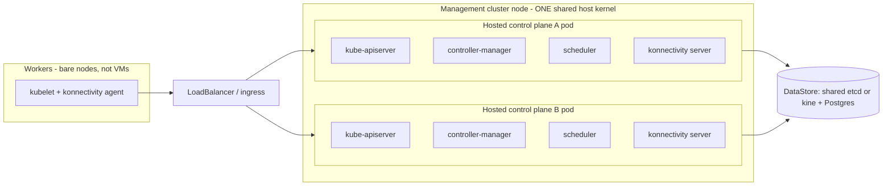
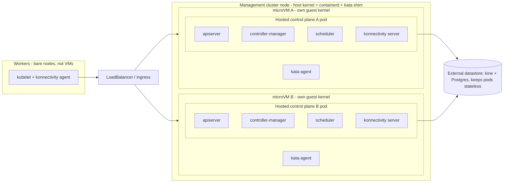
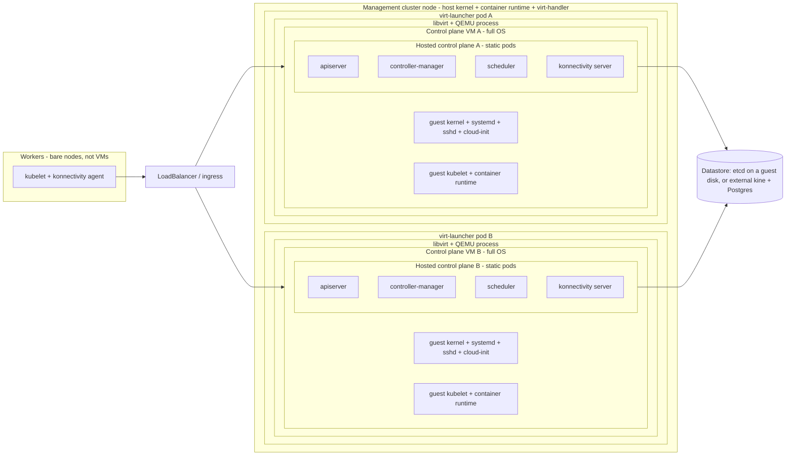

# Kata, KubeVirt, Confidential Containers, and Hosted Control Planes

Research notes (2026-11-21, revised 2026-11-22) on how KubeVirt, Kata Containers, and the
Confidential Containers (CoCo) ecosystem relate, how Kata and KubeVirt compare as isolation
layers for Kamaji-style hosted control planes, and where each would fit on this cluster.

**Provenance:** the CoCo, Kamaji, and vcluster material comes from web research (sources at
the bottom; many are vendor pages, so vendor-flavoured). The KubeVirt architecture section
reflects experiments 25-27 and 32 in this repo. Everything about how Kata and KubeVirt
would behave as control plane hosts, including overhead figures and the operator-experience
comparison, is inference from general knowledge: nothing was measured or tested. The "fit
for this cluster" section is likewise inference. No prior docs in this repo or
`home-network` cover Kata or confidential computing; the only mention anywhere is a Kata row
in `pelagos/docs/RUNTIME_STRATEGY_2026.md` (a hypervisor tier Pelagos "explicitly does not
attempt").

## Terminology

- **Management cluster:** the Kubernetes cluster that runs the hosted control planes.
- **Hosted control plane:** the apiserver and other control plane pods the management
  cluster runs on behalf of another cluster.
- **Hosted cluster:** a hosted control plane plus its workers. Here the workers are always
  ordinary bare nodes.
- **Tenant:** only the owner or user of a hosted cluster (as in "untrusted tenants"). It is
  not part of the control plane. Kamaji's CRD name `TenantControlPlane` is the one
  exception, being a proper name.
- **Operator:** the human running the infrastructure. Software that follows the Kubernetes
  operator pattern is named explicitly (e.g. `virt-operator`).
- **Controller / reconciler:** a *controller* watches resources and drives actual state
  toward the state they describe; the *reconciler* is the function inside it that runs on
  each event. A controller does not create pods or VMs directly: it writes further resource
  definitions to the API server, and other controllers (and finally the kubelet) act on
  those.
- **Node level vs API level:** *node level* is software installed on each management-cluster
  node's own OS, underneath Kubernetes, with no API object representing it (for Kata: the
  container runtime's Kata shim, the guest kernel and image, the VMM, and the RuntimeClass
  handler config). It is installed per node, diagnosed on the node host (journald, shim
  logs), and a fault there affects every pod using it on that node. *API level* is objects
  in the Kubernetes API (Deployments, VMs, Secrets), managed with `kubectl` and GitOps.

## How KubeVirt works

KubeVirt makes a VM a Kubernetes object, and runs it inside a pod. In plain terms: the
pod's container image is a normal OCI image whose process is libvirt and QEMU. The
container runtime (e.g. containerd) starts that process exactly as it starts any
container, and QEMU then boots the VM. To the runtime, the kubelet, and the scheduler this
is an ordinary pod, so KubeVirt adds nothing to the runtime: no shim, no RuntimeClass.

It is ordinary only to that machinery. Three things make it an unusual pod:

- **It needs things from the node:** `/dev/kvm` (exposed through a device plugin that
  `virt-handler` registers and passed through by the runtime), particular host paths, and
  extra memory for QEMU itself. A runtime that cannot supply these cannot run KubeVirt.
- **The container is only a wrapper.** The pod being Running means the wrapper is alive,
  not that the guest inside is healthy.
- **Kubernetes tooling stops at the wrapper:** `kubectl logs` and `kubectl exec` reach the
  launcher, not the guest.

The components:

1. **Objects.** `VirtualMachine` / `VirtualMachineInstance` (VMI) CRDs.
2. **virt-controller** watches VMIs and creates one **virt-launcher pod** per VMI. That
   pod is what the scheduler places and what carries CPU/memory requests. (The two-pod
   race bug in experiment 25 lives here.)
3. **virt-handler** is a DaemonSet (one per node). It acts on the node on the launcher's
   behalf and handles migration and node labelling.
4. **Inside the launcher pod**, `virt-launcher` runs libvirt (virtqemud), which runs
   **QEMU/KVM** against `/dev/kvm`. The guest is a full VM with its own kernel and init.
5. **virt-api** hosts webhooks and subresources (console, VNC, ssh). **virt-operator**
   installs and upgrades everything dynamically (hence the fiddly
   [suspend/resume](kubevirt-suspend-resume.md) procedure).

```
node
└── container runtime (unchanged: starts the launcher image like any other)
    └── virt-launcher pod
        └── libvirt -> QEMU process
            └── [guest: own kernel, own init]
                └── whatever the VM's owner runs
```

- **Disks** reach QEMU as a PVC, hostDisk, or container disk (an OCI image the runtime
  pulls as an extra container in the launcher pod, whose only job is carrying the disk
  file).
- **Networking:** the pod gets a normal pod IP; the guest NIC is bridged/NATed onto it, so
  Services and NetworkPolicy apply at the pod boundary.
- **Resources:** requests/limits apply to the launcher pod; guest RAM comes out of the
  pod's memory budget.
- **Observability:** to reach the guest use `virtctl console` / `virtctl ssh` / a guest
  agent.

## How Kata works

Kata is a CRI runtime selected per pod with a `RuntimeClass`. It sits **under** the
container runtime as a shim, a sibling of runc, not a replacement for it.

- containerd (or CRI-O) still does image pulls, snapshots, the CRI API, and pod/container
  lifecycle. Only the last step differs: for `runtimeClassName: kata`, it launches
  `containerd-shim-kata-v2`, which boots a microVM (QEMU, Cloud Hypervisor, or
  Firecracker) and talks to a Kata agent inside it. The agent starts the OCI containers
  in the guest.
- RuntimeClass is not replaced; it is how a pod picks a handler. `kata` is registered
  beside the default `runc`, and both can coexist on a node.
- Everything above the runtime (scheduler, kubelet, Services, probes, `kubectl logs/exec`)
  behaves as for normal pods. RuntimeClass can carry a pod-overhead value so the
  scheduler accounts for the VM's own memory.

## Kata vs KubeVirt

### Architecture

| | KubeVirt | Kata |
|---|---|---|
| Goal | Run a VM (full OS, own lifecycle) | Run a container with VM-grade isolation |
| API | New CRDs (`VirtualMachine`) | Standard pod + `runtimeClassName` |
| Where the VM boundary sits | In a pod, **above** the CRI | Inside the runtime, **below** the CRI |
| What the pod is | A wrapper around QEMU | The VM, with your containers inside |
| Who supplies the guest | The VM's owner: the whole OS / disk image | The runtime: a minimal guest; the owner supplies an OCI image |
| Guest kernel patched by | The VM's owner | The operator (ships with Kata) |
| VM visible? | Yes: first-class (`vm`, `vmi`, `vmim`, `virtctl`, live migration) | Mostly no: an implementation detail |

Kata's invisibility is only quasi. Leaks: `uname -r` shows the guest kernel, host
namespaces / `hostPath` / device access behave differently, and startup time and memory
overhead are higher.

### Where the weight is

Both put a VM under each unit. The overhead difference is **what is inside the VM and what
manages it**, not the VM itself. Overhead figures are estimates (Kata's ~50-100 MB per pod
comes from Pelagos's strategy doc); nothing here was measured.

| | Kata microVM | KubeVirt VM |
|---|---|---|
| Guest OS | Minimal kernel, tiny rootfs, `kata-agent` as essentially the only userland. No systemd, sshd, or cloud-init | General-purpose OS image: systemd, journald, sshd, cloud-init, etc. |
| Guest RAM sized for | Just the containers | An OS plus the workload |
| Management stack | Shim + VMM (QEMU, Cloud Hypervisor, or Firecracker) | `virt-launcher` + libvirt + QEMU in the pod, plus extra memory KubeVirt reserves for those processes |
| Device model | Can be trimmed to a minimum (especially Cloud Hypervisor / Firecracker) | Typically QEMU with a fuller PC-style device model and UEFI firmware |
| Boot time | Under a second to a few seconds | Seconds to tens of seconds (full OS boot) |
| API surface | None (a RuntimeClass) | `virt-operator`, 4 components, ~19 CRDs |
| Where bugs land | Node level (shim, guest kernel, VMM); can affect every Kata pod on a node | API level: stuck VMIs, races |
| What you maintain | Guest kernel and shim versions, per node | The KubeVirt install, **plus the OS inside every VM** |

The gap is a default, not a law. A stripped-down Linux guest in KubeVirt shrinks its
overhead a lot, and Kata with QEMU is not free (a VMM process and guest kernel per pod).
Kata's guest is minimal by design; KubeVirt's is whatever the VM's owner brings.

### Runtime portability: containerd vs a custom-CRI runtime (e.g. Pelagos)

The two differ most sharply here, and it is structural:

- **KubeVirt sits above the CRI.** It only needs the runtime to run a launcher pod with
  `/dev/kvm`, so it is portable across runtimes.
- **Kata sits below the CRI.** It plugs in as a shim v2 host in containerd/CRI-O, so it is
  only as portable as the runtime's support for that interface.

| | containerd / CRI-O (net-new) | Custom-CRI runtime (Pelagos) |
|---|---|---|
| Kata | First-class: shim, usually installed via `kata-deploy`; mainstream, well-trodden | Needs the runtime to host shim v2 or launch Kata itself, a feature the runtime's authors must build. Not checked whether Pelagos has or plans this |
| KubeVirt | Works, independent of the runtime | Works unchanged, for the same reason |

## Hosted control planes: Kamaji vs vcluster

Web research (the best head-to-head comparisons found were on vCluster's own blog, so
treat them as vendor-biased; the projects' own docs were preferred where they disagreed).

| | Kamaji | vcluster |
|---|---|---|
| Model | `TenantControlPlane` CRD; each hosted control plane's apiserver and controller components run as pods in a management cluster, built on kubeadm | Virtualizes the control plane; a syncer translates objects between the virtual and host clusters |
| Datastore | Separate and declarative via a `DataStore` CRD. Shared etcd by default, dedicated etcd optional, kine allows MySQL/Postgres | Not confirmed in sources |
| Worker nodes | Out of scope: you bring nodes, no lifecycle management | Four modes: shared, dedicated, private (v0.27+), standalone (v0.29+) |
| Control plane to node path | Konnectivity reverse tunnel, sidecar in every hosted control plane pod | Depends on mode |
| Cluster API | Control plane provider (`KamajiControlPlane`) | Not found in sources |

One vCluster post claims Kamaji runs a dedicated etcd per hosted control plane; Kamaji's
own docs say shared by default, so the docs were followed.

For integration into a larger system:

- **Kamaji is infrastructure-shaped.** One job (control planes as pods), exposed through a
  CAPI provider so fleet tooling can drive it. Fits cluster-as-a-service platforms.
- **vcluster is virtual-cluster-shaped.** In shared-node mode, workloads from different
  virtual clusters share the host's kernel and nodes; vcluster's docs say that is not a
  security boundary for untrusted tenants. Private-node mode moves toward Kamaji's territory.

### What Kamaji looks like

Hosted control planes are ordinary pods on the management cluster's nodes, so they share
the host kernel (separated by namespaces and cgroups only). Bare-node workers connect
inward through a load balancer.



## Building a Kamaji replacement: Kata vs KubeVirt for the control planes

Stipulated scenario (not this cluster): a homegrown replacement for Kamaji-style hosted
control planes, with bare-node workers joining over the network. The comparison is for the
control planes only. The reference point is **Kamaji parity**: anything Kamaji does not do
is an extra, not a requirement.

**What is being isolated:** an apiserver, controller-manager, scheduler, Konnectivity
server, and a datastore client (etcd or kine). Bare-node workers connect inward to the
apiserver and Konnectivity server, so both must be reachable from outside the cluster (true
for every option below). The threat model is hosted control planes sharing a kernel: an
escape from one control plane's apiserver pod would expose other control planes'
certificates and secrets. VM-level isolation closes that gap.

**What Kamaji actually does** (from general knowledge; the pod placement is the easy part):

1. A controller that watches a hosted-control-plane resource and writes the pods and
   supporting resources for it (the easy, visible part).
2. PKI: per-cluster CA, certificates, kubeconfigs, and their rotation (hard to get right).
3. Datastore provisioning for each hosted control plane, with real isolation if shared.
4. Konnectivity server in the control plane pod, agent on the hosted cluster's workers.
5. Addons (CoreDNS, Konnectivity agent) installed via the hosted cluster's own apiserver.
6. Worker bootstrap: join tokens, kubeadm-style.
7. Upgrades and version-skew handling.
8. The CAPI contract: control plane endpoint, ready/initialized status, kubeconfig secret.

**Three ways to host the control plane.** Plain pods (Kamaji today) are the lightest and win
on density when VM-grade isolation between hosted control planes is not required. Kata and
KubeVirt both add that isolation. VMs do not inherently reduce resource use; savings come
from packing many control planes onto shared nodes.

### Kata for the control planes

Same pod shape as Kamaji, but each hosted control plane pod runs inside its own microVM
with its own guest kernel. The VM boundary sits at the pod, so all the pod's containers
share one VM.



- **Shape:** the controller writes the same Deployment/StatefulSet it would for plain pods,
  with `runtimeClassName: kata`. That puts the whole pod in **one microVM**, however many
  sidecars it has.
- **Overhead:** small per hosted control plane (~50-100 MB estimate, not measured).
- **HA:** several apiserver replicas on different nodes. The apiserver is stateless, so
  live migration is not needed and Kata's lack of it does not matter.
- **Datastore:** external kine/Postgres (makes the control plane pods stateless) or a
  separate etcd StatefulSet. etcd under Kata needs fsync latency measured; with an external
  database the same concern moves to the database.
- **Networking:** ordinary Services and LoadBalancers. Kata bridges the pod network into the
  VM, which may cost some network performance (not measured).

### KubeVirt for the control planes

Each hosted control plane runs in its own VM. The VM contains only the control plane (the
hosted cluster's workers are still bare nodes, shown on the left). The management cluster
runs only a launcher pod around QEMU; the control plane lives inside a guest OS that the
operator has to build, bootstrap, and patch. Here the control plane is shown as static pods
under a guest kubelet (systemd units are the alternative).



- **Shape:** the controller writes VM-level resources. Each hosted control plane gets one or
  more VMs with the control plane running inside as systemd units or as static pods under a
  kubelet (a kubelet and container runtime per control plane VM).
- **Overhead:** much higher per hosted control plane: OS, services, and a kubelet and
  runtime or hand-built systemd units.
- **Bootstrap:** PKI and config injected through cloud-init or similar, not mounted Secrets.
- **Extras beyond Kamaji parity (not required):** live migration, disk snapshots (useful
  for an etcd disk), and a control plane that behaves like a normal machine. Kamaji has none
  of these; it gets availability from replicated control plane pods instead.

### How a control plane gets created

In both designs the operator applies one resource describing the hosted control plane (the
analogue of `TenantControlPlane`). The replacement's controller observes it and writes
lower-level resource definitions. It creates nothing itself; downstream controllers act on
what it writes.

```
Kata:     operator applies hosted-control-plane resource
          -> our controller writes Deployment/StatefulSet (runtimeClassName: kata), Service, Secrets
          -> Deployment/ReplicaSet controllers create Pods -> scheduler binds -> kubelet
          -> containerd -> Kata shim -> microVM -> control plane containers

KubeVirt: operator applies hosted-control-plane resource
          -> our controller writes VirtualMachine, disk/PVC, cloud-init Secret, Service
          -> virt-controller creates the VMI and virt-launcher pod -> scheduler binds -> kubelet
          -> runtime runs the launcher -> libvirt/QEMU -> guest boots -> guest runs the control plane
```

The difference is what the controller writes. With Kata it is the same resources as for
plain pods plus one field. With KubeVirt it writes VM-level resources and must also supply
everything the guest needs to bootstrap, which is the extra controller complexity.

### Operator experience

What the human operator does day to day once control planes are running. With Kata they
manage Kubernetes objects and the microVM is a runtime detail. With KubeVirt they manage
two layers: the VM object, its launcher pod and the host, and a guest OS running the
control plane, each with its own tooling, logs, and failure modes.

| Task | Kata | KubeVirt |
|---|---|---|
| Node-level work | Install and upgrade shim, guest kernel, and RuntimeClass per node (e.g. `kata-deploy` or node provisioning) | None beyond the runtime and `virt-handler`; the KubeVirt install itself is API level |
| See what's running | `kubectl get pods` | `kubectl get vmi`, then look inside the guest |
| Logs | `kubectl logs apiserver` | `kubectl logs` shows the launcher only; guest logs need `virtctl console/ssh` or an in-guest shipper |
| Shell in | `kubectl exec` | `virtctl ssh/console` into a guest OS |
| Health checks | Normal probes per component | Probes on the VM as a whole (KubeVirt supports readiness/liveness probes on a VMI, I believe); per-component health comes from inside the guest |
| Metrics | Per-pod and per-container from the usual stack | Launcher and VM level from the host; per-component usage lives inside the guest |
| Resource sizing | Per-container requests and limits, plus RuntimeClass overhead | One size for the whole VM; per-component limits only via guest cgroups |
| Upgrade a control plane | Bump the image tag, rolling update | Roll the VM: rebuild or replace the OS image, or upgrade in place inside the guest |
| Rotate certificates | Secret volumes, updated like any pod (verify how Kata propagates secret updates) | As I understand it, KubeVirt exposes Secrets as disk images that are not live-updated, so rotation may need a restart or an in-guest agent (verify) |
| Drain a node | Pod reschedules, replicas cover it | VM restarts, or live-migrates if configured |
| Scale | Change replicas | A pool of VMs, each a separate OS |

**Where failures show up.** Kata breaks at the node level: a bad shim, guest kernel, or VMM
can hit every Kata pod on a node, and diagnosis needs node access and Kata's own logs and
console, not `kubectl` alone. In the normal case the operator never thinks about the VM.
KubeVirt makes the VM an everyday concern: the launcher pod can be Running while the guest
is hung or still booting, so without guest-aware probes Kubernetes shows healthy; guest OS
patching becomes routine across every control plane VM; and a bad apiserver flag means
getting into the guest, not editing a pod spec.

### Net

| | Kata | KubeVirt |
|---|---|---|
| Density | High | Low |
| Isolation | VM-grade | VM-grade |
| Fits Kamaji's pod model | Yes | No, a different architecture |
| Controller complexity | Close to Kamaji's | Larger (VM lifecycle + guest bootstrap) |
| Operator experience | Stays in the Kubernetes workflow | Two layers: VM and guest OS |
| Easiest on a new containerd cluster | Yes | Works, but heavier |
| Works on any CRI runtime | Only with shim v2 support | Yes |
| Live migration, disk snapshots (beyond Kamaji parity, not required) | No | Yes |

For a Kamaji replacement, Kata is the better fit: it keeps the pod model that makes Kamaji
dense and the operator workflow they already have, and adds isolation as a pod-spec setting.
Both options give VM-grade isolation, and KubeVirt additionally puts an OS to build and patch
under every control plane. Its extras are not part of Kamaji's feature set, so they are not
requirements for parity; they would matter only if a requirement beyond Kamaji's appeared,
and at that point most of what the pod-based approach buys is lost. On a custom-CRI runtime
KubeVirt is the only option until that runtime supports Kata. The deciding question is
whether VM-grade isolation between hosted control planes is needed or only efficiency.

**Where the effort would go:** PKI rotation, upgrade orchestration, and datastore isolation
between hosted control planes look small and are not. If the motivation is a missing
feature, extending or wrapping Kamaji is likely cheaper than replacing it; if it is
governance, licensing, or integration shape, a replacement makes more sense and the CAPI
contract is the part to design first.

## Confidential Containers (CoCo)

CoCo is a CNCF sandbox project (status per a June 2026 arXiv paper; incubation not
confirmed) that runs each pod in a TEE-backed VM using Kata. Kata alone protects the host
from the workload; CoCo's threat model is the reverse, protecting the workload from an
untrusted host or cluster admin.

- **Trustee:** attestation service + key broker (KBS). The pod VM proves its identity and
  measurements; secrets are released only if attestation passes.
- **In-guest components:** Attestation Agent and Confidential Data Hub fetch secrets and
  manage encrypted data. Images are pulled inside the guest so the host never sees them in
  plaintext.
- **Peer pods:** variant for clouds without nested virtualization. The `kata-remote`
  runtime class creates the pod VM as a separate cloud instance instead of nesting it.
- **Recent (2026):** OpenShift sandboxed containers 1.12 + Trustee 1.1 (April 2026) added
  bare metal and AI workload support, plus GPU attestation via NVIDIA NRAS with Trustee
  proxying.
- Inverts Kata's invisibility: the VM boundary stays invisible to the workload's owner but
  becomes visible in their **trust model**, since attestation is how they verify it.

### KubeVirt's separate confidential track

Different mechanism from CoCo, and it applies to full VMs, not pods.

- **AMD SEV-SNP:** experimental since v1.7.0 via `launchSecurity.snp`. Requires the
  `WorkloadEncryptionSEV` feature gate, UEFI boot, SecureBoot disabled in the guest. No
  live migration, no attestation.
- **Intel TDX:** proof of concept as of November 2025 (sidecar tells QEMU to apply
  protections; Trustee for attestation; needs Linux 6.16+). No release note found
  confirming upstream support since. Verify before relying on it.

## Fit for this cluster (inference, untested)

- **No confidential hardware.** i5-12500/12500T have no TDX or SEV-SNP; the Spark is ARM.
  True CoCo with hardware attestation is not possible. CoCo has a no-TEE mode, useful
  only for learning the plumbing.
- **Plain Kata is feasible in principle.** The nodes have working `/dev/kvm` (KubeVirt
  runs on them), so Kata microVM isolation has the hardware it needs.
- **Pelagos conflict.** Kata plugs in via containerd/CRI-O shim v2. The nodes use
  `pelagos-cri` as the entire CRI endpoint, so there is no containerd to host the shim.
  Pelagos would have to speak shim v2 or launch Kata itself. Not yet checked. Per the
  project rule, Pelagos-as-root-cause means file an issue and alert, not work around.
- **Closest fit today:** KubeVirt already provides hardware-isolated guests. Kata would add
  per-pod isolation for ordinary containers; CoCo would add attestation on top.

## Open questions

- Does Pelagos's CRI support (or plan) shim v2 / Kata? (Decides whether Kata is an option
  at all here.)
- Has KubeVirt TDX support landed upstream since November 2025?
- Has CoCo moved past CNCF sandbox?
- Does Kamaji already expose a runtime class on its control plane pods? If so, Kamaji plus
  Kata may remove the need for a replacement.
- What is vcluster's datastore and Cluster API story? (Not found in the sources used.)
- How does KubeVirt deliver Secret volumes (live-updated or static disk images)? How does
  Kata propagate Secret updates into the guest? Both bear on certificate rotation.

## Sources

- [What are Confidential Containers? (Red Hat)](https://www.redhat.com/ja/blog/learn-about-confidential-containers)
- [arXiv 2606.03323](https://arxiv.org/html/2606.03323)
- [Red Hat Trustee docs, bare metal](https://docs.redhat.com/en/documentation/openshift_sandboxed_containers/1.12/html/deploying_red_hat_build_of_trustee_for_workloads_running_on_bare-metal_servers/trustee-discover_metal-trustee)
- [Confidential containers on OpenShift bare metal (Red Hat Developer)](https://developers.redhat.com/index%2Ephp/articles/2026/06/04/overview-confidential-containers-openshift-bare-metal)
- [KubeVirt confidential computing docs](https://kubevirt.io/user-guide/cluster_admin/confidential_computing/)
- [Intel TDX VMs with Trustee on OpenShift](https://developers.redhat.com/articles/2025/11/05/setting-intel-tdx-vms-trustee-openshift)
- [KubeVirt and Kata use cases (Superuser)](https://superuser.openinfra.org/articles/kubevirt-kata-containers-vm-use-case/)
- [vCluster: Kamaji vs vCluster (vendor)](https://www.vcluster.com/blog/kamaji-vs-vcluster-kubernetes-scaling)
- [Kamaji: tenant control plane](https://kamaji.clastix.io/concepts/tenant-control-plane/)
- [Kamaji: datastore](https://kamaji.clastix.io/concepts/datastore/)
- [Kamaji: Konnectivity](https://kamaji.clastix.io/concepts/konnectivity/)
- [kmetal: hosted control plane](https://kmetal.clastix.io/docs/concepts/hosted-control-plane/)
- [vCluster architecture overview](https://www.mintlify.com/loft-sh/vcluster/architecture/overview)
- [vCluster nodes](https://www.vcluster.com/docs/architecture/nodes)
- [vCluster v0.27 private nodes](https://vcluster.com/blog/vcluster-v-027-private-nodes)
