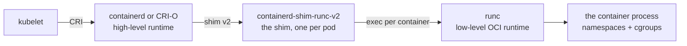
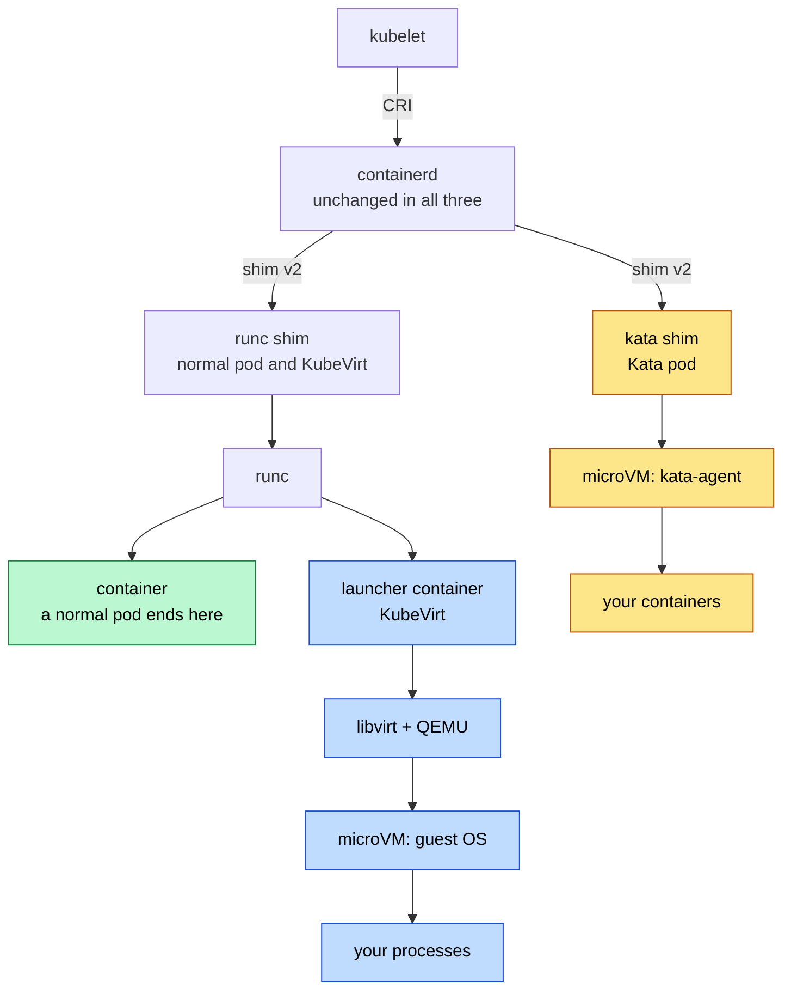
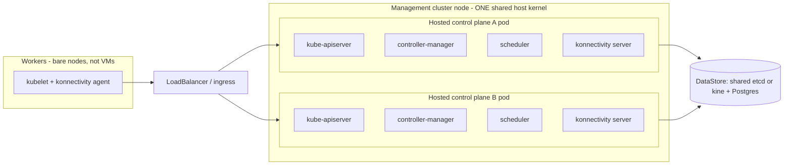
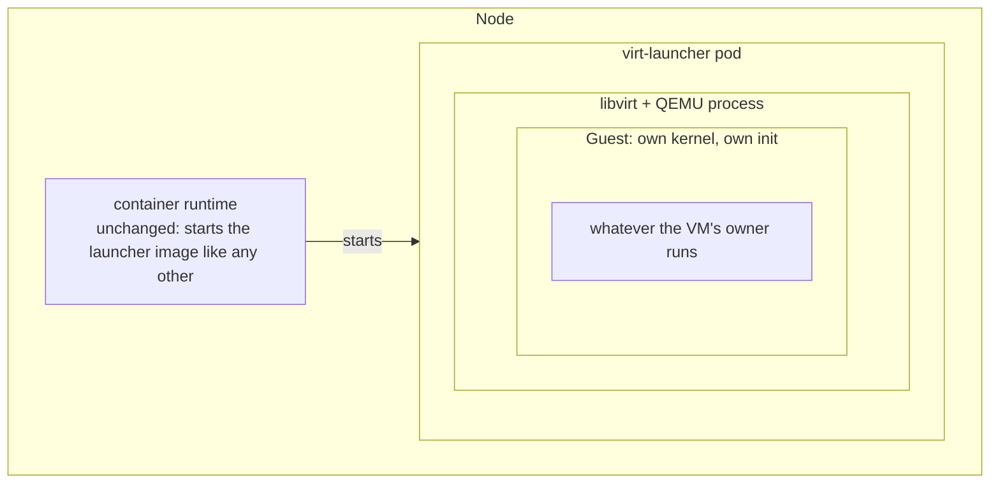
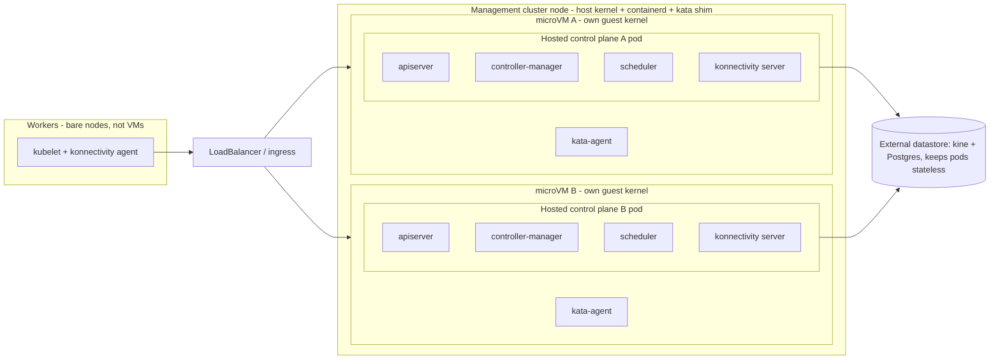
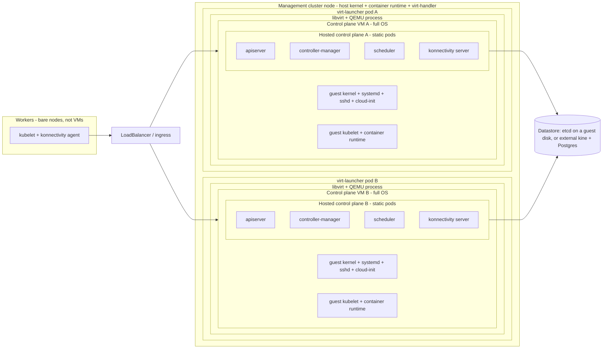
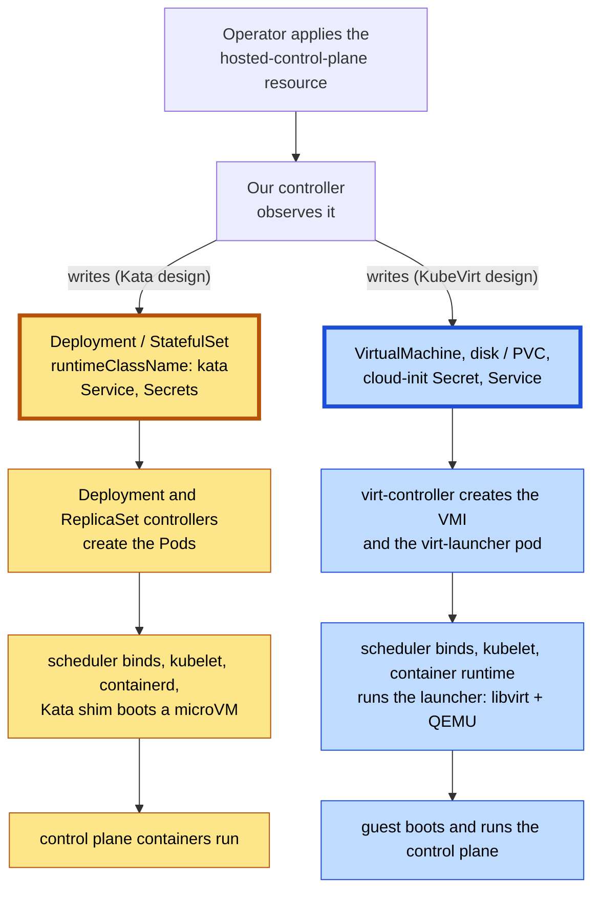

# Purpose and scope {#sec-purpose}

## Goal

Kamaji's hosted control planes will be replaced by a homegrown implementation. That
decision is made elsewhere and is not revisited here. The open decision is **what hosts the
replacement's control planes**. Two technologies are available to the project, and the
replacement will use one of them:

- **Kata Containers**: each control plane pod runs inside its own microVM, selected with a
  Kubernetes `RuntimeClass`.
- **KubeVirt**: each control plane runs inside its own full VM, managed as a Kubernetes
  `VirtualMachine` object.

This paper scores the two against four criteria (weight, complexity, reliability and
resilience in operations, and incident debugging and mitigation) and lays out the data
behind the scores so that any reader can check it. **It takes no side.**

## Scope and stipulations

- **In scope:** choosing between Kata and KubeVirt as the isolation layer for hosted control
  planes.
- **Out of scope:** why Kamaji is being replaced; other candidates (vcluster appears only as
  reference material in [Appendix B](#app-vcluster)); confidential computing, which is
  background only ([Appendix C](#app-coco)).
- **Target environment:** workloads use SPIFFE/SPIRE identity, and Konnectivity has been
  removed where possible (see [5.6](#sec-identity) and [5.7](#sec-connectivity)).
- **Workers are ordinary bare nodes** in every design. No design in this paper puts tenant
  workers in VMs. Only the control planes are isolated.
- Terms such as *hosted control plane* and *node level* are defined in
  [Appendix A](#app-terms).

## How to read this paper

- **Decision-makers:** this section, then [Decision criteria](#sec-criteria),
  [Scorecard](#sec-scorecard), [Viability](#sec-viability) and
  [Decision guide](#sec-decision).
- **Readers new to one of the technologies:** [Background](#sec-background).
- **Readers checking the scores:** [Analysis](#sec-analysis).

## Evidence labels

Most of the analysis is inference, so every claim of consequence carries a label:

- **[S]**: from a cited source or product documentation.
- **[M]**: measured in a throwaway test (`experiments/34-kubevirt-secret-propagation/`,
  a single run).
- **[I]**: inference from general knowledge. Not measured or tested here.
- **[?]**: unverified or open; listed in [Appendix D](#app-open).

Overhead figures are estimates. Apart from the Secret-propagation test marked [M], nothing
in this paper was measured, and the [validation plan](#sec-spike) is how that would change.

# Decision criteria {#sec-criteria}

Four criteria families, each split into sub-criteria. Scores in the
[scorecard](#sec-scorecard) run from 1 to 5, where 5 is best for the operator running the
system.

| Family | Question it answers | Sub-criteria |
|----------|------------|--------------------|
| **A. Weight** (light vs heavy) | What does it cost to run, per control plane and as a platform? | A1 per-control-plane overhead; A2 platform footprint |
| **B. Complexity** (simple vs complex) | How much must we build, learn, and keep consistent? | B1 what our controller must build; B2 guest OS lifecycle; B3 coupling to the runtime |
| **C. Reliability and resilience** | How does it behave when parts fail, and when we change it? | C1 failure blast radius; C2 HA and self-healing; C3 upgrade and rollback safety |
| **D. Incident debugging and mitigation** | When it breaks at 3 a.m., how fast can we see why and fix it? | D1 visibility in standard tooling; D2 silent-failure risk; D3 diagnosing platform faults; D4 mitigation toolbox |

The criteria do not capture everything a team might care about. See
[what the scorecard does not cover](#sec-notcovered).

# Background {#sec-background}

## The container stack {#sec-stack}

Both technologies are described in terms of this stack, so its layers come first.



- **kubelet** speaks CRI and knows nothing about runc.
- **containerd / CRI-O** is the high-level runtime: it serves CRI, pulls images, manages
  snapshots and storage, creates the pod sandbox, and tracks container lifecycle. It does
  not start the container process itself.
- **The shim** is a small long-lived process per pod, spoken to over the shim v2 API. It
  launches the low-level runtime, stays alive after that exits to hold stdio and report the
  exit status, and is why containers survive a containerd restart.
- **runc** is the low-level OCI runtime: given an OCI bundle (a rootfs plus a config), it
  sets up namespaces and cgroups, execs the process, and exits. crun, youki, and gVisor's
  `runsc` fill the same role.
- containerd picks the shim from the pod's RuntimeClass handler (`io.containerd.runc.v2`
  for normal pods, `io.containerd.kata.v2` for Kata).

The three cases in one diagram (a normal pod in green, a Kata pod in amber, a KubeVirt VM in
blue). They share kubelet and containerd, and each diverges at a fork: Kata at the shim,
KubeVirt only after the launcher container exists.



- **KubeVirt takes the standard path** down to the launcher container and diverges only
  after that container exists: the VM is created by a process *inside* a container.
- **Kata diverges earlier**, at the shim: the VM is created by the runtime itself, before
  any container exists.
- Both end up with a microVM below the pod, but created by different things at different
  layers. That is the structural difference behind "above the CRI" (KubeVirt) and "below
  the CRI" (Kata).
- KubeVirt's other components (`virt-handler` on each node, `virt-controller` and
  `virt-api` in the control plane) are not layers in this stack. They are
  Kubernetes-side machinery that creates the launcher pod and manages the VM.

## Kamaji, the system being replaced {#sec-kamaji}

Kamaji runs each hosted control plane as ordinary pods on a management cluster's nodes, so
control planes share the host kernel (separated by namespaces and cgroups only). A
`TenantControlPlane` resource describes each one. Bare-node workers connect inward through a
load balancer.



**What Kamaji does** [S] (sources in [Appendix E](#app-sources); the pod placement is the
easy part):

1. A controller that watches a hosted-control-plane resource and writes the pods and
   supporting resources for it (the easy, visible part).
2. PKI: per-cluster CA, certificates, kubeconfigs, and their rotation (hard to get right).
3. Datastore provisioning for each hosted control plane, with real isolation if shared.
   Kamaji separates the datastore declaratively (a `DataStore` resource): shared etcd by
   default, dedicated etcd optional, and kine allows MySQL or Postgres.
4. Konnectivity server in the control plane pod, agent on the hosted cluster's workers.
5. Addons (CoreDNS, Konnectivity agent) installed via the hosted cluster's own apiserver.
6. Worker bootstrap: join tokens, kubeadm-style. Kamaji does not manage worker lifecycle.
7. Upgrades and version-skew handling.
8. The Cluster API (CAPI) contract: control plane endpoint, ready/initialized status,
   kubeconfig secret. Kamaji ships a CAPI control plane provider.

**The threat model that motivates isolation:** hosted control planes sharing a kernel. An
escape from one control plane's apiserver pod would expose other control planes'
certificates and secrets. A VM boundary closes that gap. Both candidates provide one.

## KubeVirt {#sec-kubevirt}

KubeVirt makes a VM a Kubernetes object, and runs it inside a pod. In plain terms: the
pod's container image is a normal OCI image whose process is libvirt and QEMU. The
container runtime (e.g. containerd) starts that process exactly as it starts any
container, and QEMU then boots the VM. To the runtime, the kubelet, and the scheduler this
is an ordinary pod, so KubeVirt adds nothing to the runtime: no shim, no RuntimeClass (see
[the stack diagram](#sec-stack)).

It is ordinary only to that machinery. Three things make it an unusual pod:

- **It needs things from the node:** `/dev/kvm` (exposed through a device plugin that
  `virt-handler` registers and passed through by the runtime), particular host paths, and
  extra memory for QEMU itself. A runtime that cannot supply these cannot run KubeVirt.
- **The container is only a wrapper.** The pod being Running means the wrapper is alive,
  not that the guest inside is healthy.
- **Kubernetes tooling stops at the wrapper:** `kubectl logs` and `kubectl exec` reach the
  launcher, not the guest.

The components:

1. **Objects.** `VirtualMachine` / `VirtualMachineInstance` (VMI) CRDs.
2. **virt-controller** watches VMIs and creates one **virt-launcher pod** per VMI. That
   pod is what the scheduler places and what carries CPU/memory requests.
3. **virt-handler** is a DaemonSet (one per node). It acts on the node on the launcher's
   behalf and handles migration and node labelling.
4. **Inside the launcher pod**, `virt-launcher` runs libvirt (virtqemud), which runs
   **QEMU/KVM** against `/dev/kvm`. The guest is a full VM with its own kernel and init.
5. **virt-api** hosts webhooks and subresources (console, VNC, ssh). **virt-operator**
   installs and upgrades everything dynamically.



- **Disks** reach QEMU as a PVC, hostDisk, or container disk (an OCI image the runtime
  pulls as an extra container in the launcher pod, whose only job is carrying the disk
  file).
- **Networking:** the pod gets a normal pod IP; the guest NIC is bridged/NATed onto it, so
  Services and NetworkPolicy apply at the pod boundary.
- **Resources:** requests/limits apply to the launcher pod; guest RAM comes out of the
  pod's memory budget.
- **Observability:** to reach the guest use `virtctl console` / `virtctl ssh` / a guest
  agent.

**The case for KubeVirt** (its strongest points):

- It is portable across runtimes: it needs only a launcher pod with `/dev/kvm` [S].
- The VM is a first-class object, so operators get VM verbs: console, ssh, snapshot, live
  migration [S].
- The guest is a normal OS, so debugging uses familiar Linux tooling [I].
- It is a general-purpose platform with a wide ecosystem, including a Cluster API provider
  for VM-based clusters [S].

**Known limits:**

- It is heavier per instance and as a platform: a guest OS per control plane, plus an
  operator, four components and about 19 CRDs [S].
- Two layers to operate (the VM object and the guest OS), and the OS inside every control
  plane VM must be built and patched [I].
- Secret delivery matters for certificate rotation. Delivered as a disk (an ISO), a Secret
  never updates in a running guest; delivered as a virtiofs filesystem, it does (about 78 s
  in one measurement, bounded by the kubelet's Secret sync) [S][M]. Rotation therefore needs
  the filesystem mode, which needs virtiofs support in the guest kernel, and whether
  virtiofs-delivered config blocks live migration is unconfirmed [?].

## Kata Containers {#sec-kata}

Kata is selected per pod with a `RuntimeClass`. It sits **under** the high-level runtime
(containerd or CRI-O) as a replacement for the runc *shim*: it implements the same shim v2
interface, but where the runc shim calls runc, the Kata shim boots a microVM (see
[the stack diagram](#sec-stack)). It plays the shim and low-level runtime roles together; it
is a sibling of `containerd-shim-runc-v2`, not of runc itself.

- containerd (or CRI-O) still does image pulls, snapshots, the CRI API, and pod/container
  lifecycle. Only the last step differs: for `runtimeClassName: kata`, it launches
  `containerd-shim-kata-v2`, which boots a microVM (QEMU, Cloud Hypervisor, or
  Firecracker) and talks to a Kata agent inside it. The agent starts the OCI containers
  in the guest.
- RuntimeClass is not replaced; it is how a pod picks a handler. `kata` is registered
  beside the default `runc`, and both can coexist on a node.
- Everything above the runtime (scheduler, kubelet, Services, probes, `kubectl logs/exec`)
  behaves as for normal pods. RuntimeClass can carry a pod-overhead value so the
  scheduler accounts for the VM's own memory.
- The VM boundary sits at the **pod**, so all of a pod's containers share one microVM.

**The case for Kata** (its strongest points):

- It is the lighter of the two per instance: a minimal guest with no general-purpose OS
  [I].
- The control plane stays ordinary pods, so existing Kubernetes tooling, GitOps, probes and
  metrics keep working unchanged [S].
- No guest OS to build and patch per control plane; the guest kernel ships with Kata and
  is managed per node [S].
- No new API surface in the cluster beyond a RuntimeClass [S].

**Known limits:**

- Needs a runtime that hosts shim v2 (containerd or CRI-O) and a per-node install of the
  shim, guest kernel and image [S].
- The VM machinery is node-level: a bad shim, guest kernel image or VMM version affects
  every pod that shares it on that node [I].
- No live migration; storage reaches the guest through an extra layer (virtio-fs or a block
  device), which matters for etcd's fsync-latency sensitivity [I].
- "Invisible VM" is only quasi: `uname -r` shows the guest kernel, host namespaces,
  `hostPath` and device access behave differently, and startup time and memory overhead are
  higher [S].

# The two designs {#sec-designs}

For each design, the controller we build stays the same shape: it watches a hosted
control plane resource and writes lower-level resources. What differs is what it writes
and where the VM boundary falls. Plain pods without a VM (Kamaji today) are the reference
point for density; VMs do not inherently reduce resource use, since savings come from
packing many control planes onto shared nodes.

## Kata design {#sec-design-kata}

Same pod shape as Kamaji, but each hosted control plane pod runs inside its own microVM
with its own guest kernel. All the pod's containers share one VM.



- **Shape:** the controller writes the same Deployment/StatefulSet it would for plain pods,
  with `runtimeClassName: kata`.
- **Overhead:** small per hosted control plane (~50-100 MB estimate [I]).
- **HA:** several apiserver replicas on different nodes. The apiserver is stateless, so
  live migration is not needed [I].
- **Datastore:** external kine/Postgres (makes the control plane pods stateless) or a
  separate etcd StatefulSet. etcd under Kata needs fsync latency measured; with an external
  database the same concern moves to the database [I].
- **Networking:** ordinary Services and LoadBalancers. Kata bridges the pod network into the
  VM, which may cost some network performance [?].

```{=latex}
\newpage
```

## KubeVirt design {#sec-design-kubevirt}

Each hosted control plane runs in its own VM. The VM contains only the control plane (the
hosted cluster's workers are still bare nodes, shown on the left). The management cluster
runs only a launcher pod around QEMU; the control plane lives inside a guest OS that the
operator has to build, bootstrap, and patch. Here the control plane is shown as static pods
under a guest kubelet (systemd units are the alternative).



- **Shape:** the controller writes VM-level resources. Each hosted control plane gets one or
  more VMs with the control plane running inside as systemd units or as static pods under a
  kubelet (a kubelet and container runtime per control plane VM).
- **Overhead:** much higher per hosted control plane: OS, services, and a kubelet and
  runtime or hand-built systemd units [I].
- **Bootstrap:** PKI and config injected through cloud-init or similar, not mounted Secrets
  [I].
- **HA:** multiple VMs per control plane, or a single VM restarted or live-migrated
  (migration needs shared RWX storage) [I].
- **Beyond what Kamaji offers:** live migration, disk snapshots (useful for an etcd disk),
  and a control plane that behaves like a normal machine. Nobody requires these, but they
  are credited as incident tools under D4 in the [scorecard](#sec-scorecard).

## How a control plane gets created {#sec-chain}

In both designs the operator applies one resource describing the hosted control plane (the
analogue of `TenantControlPlane`). The replacement's controller observes it and writes
lower-level resource definitions. It creates nothing itself; downstream controllers act on
what it writes.



Amber is the Kata design, blue the KubeVirt design. The thick-bordered nodes are the
resource definitions our controller writes; everything after them is done by other
controllers and the node.

# Analysis against the criteria {#sec-analysis}

## A. Weight {#sec-weight}

Both put a VM under each unit. The overhead difference is **what is inside the VM and what
manages it**, not the VM itself. All figures are estimates [I] (Kata's ~50-100 MB per pod
is a published estimate for Kata 3.x); nothing was measured.

| | Kata microVM | KubeVirt VM |
|---|---|---|
| Guest OS | Minimal kernel, tiny rootfs, `kata-agent` as essentially the only userland. No systemd, sshd, or cloud-init | General-purpose OS image: systemd, journald, sshd, cloud-init, etc. |
| Guest RAM sized for | Just the containers | An OS plus the workload |
| Management stack | Shim + VMM (QEMU, Cloud Hypervisor, or Firecracker) | `virt-launcher` + libvirt + QEMU in the pod, plus extra memory KubeVirt reserves for those processes |
| Device model | Can be trimmed to a minimum (especially Cloud Hypervisor / Firecracker) | Typically QEMU with a fuller PC-style device model and UEFI firmware |
| Boot time | Under a second to a few seconds | Seconds to tens of seconds (full OS boot) |
| API surface | None (a RuntimeClass) | `virt-operator`, 4 components, ~19 CRDs |
| Where the VM machinery lives | On the node, outside the API: shim, guest kernel and image, VMM, RuntimeClass config | At the API level: operator, launcher image, VM image and objects |
| What you maintain | Guest kernel and shim versions, per node | The KubeVirt install, **plus the OS inside every VM** |

The gap is a default, not a law. A stripped-down Linux guest in KubeVirt shrinks its
overhead a lot, and Kata with QEMU is not free (a VMM process and guest kernel per pod).
Kata's guest is minimal by design; KubeVirt's is whatever the VM's owner brings.

## B. Complexity {#sec-complexity}

**B1, what our controller must build.** With Kata, the controller writes the same resources
as for plain pods plus one field. With KubeVirt it writes VM-level resources and must also
supply everything the guest needs to bootstrap (images, cloud-init, PKI injection). See
[how a control plane gets created](#sec-chain).

**B2, guest OS lifecycle.** With Kata the guest kernel ships with the Kata install and is
patched per node by the operator. With KubeVirt the OS inside every control plane VM is
built, patched and kept consistent by whoever owns the images.

**B3, coupling to the runtime.** This is structural and differs sharply:

- **KubeVirt sits above the CRI.** It only needs the runtime to run a launcher pod with
  `/dev/kvm`, plus a few node paths and cgroup access, so it is portable across runtimes.
- **Kata sits below the CRI.** It plugs in as a shim v2 host in containerd/CRI-O, so it is
  only as portable as the runtime's support for that interface.

| | Runtime hosts shim v2 (containerd / CRI-O) | Runtime without shim v2 support |
|---|---|---|
| Kata | First-class: shim, usually installed via `kata-deploy`; mainstream, well-trodden | Needs the runtime to host shim v2 or launch Kata itself, a feature the runtime's authors must build |
| KubeVirt | Works, independent of the runtime | Works, subject to the runtime supplying devices, paths and cgroups |

Which column applies depends on the target deployment's runtime. This is the single
criterion most sensitive to deployment facts this paper does not have (see the
[sensitivity analysis](#sec-sensitivity)).

## C. Reliability and resilience {#sec-reliability}

**Where the VM machinery lives.** This is the structural difference behind much of this
family. Kata's machinery (the shim, the guest kernel and image, the VMM, and the
RuntimeClass handler config) lives **on the node**, outside the Kubernetes API, and is
installed per node. A `kata-deploy` DaemonSet is a common way to do that, which makes the
rollout API-driven even though the artifacts are node-level. KubeVirt's machinery lives
**at the API level**: the operator, the launcher image that carries QEMU and libvirt, and
the guest image and VM objects, all changed with ordinary Kubernetes rollout mechanisms [S].

**C1, failure blast radius.** Each microVM runs its own kernel instance, so running state
is never shared between pods. What is shared is the artifacts: every pod using a Kata
handler on a node boots the same guest kernel image and runs the same shim and VMM
versions. A bad version or config therefore affects all of them, mostly as pods start or
restart (a running microVM keeps what it booted with), and a latent bug can fail them
together on a common trigger [I]. The QEMU and libvirt binaries are shared in the same way
under KubeVirt, since they ship in the launcher image, so that part is a push. The
difference is the guest image: Kata's is uniform by design, while a KubeVirt guest image can
easily vary per VM (staged rollouts, a canary image), though if every control plane VM uses
one standard image the exposure is the same. KubeVirt's controllers are cluster-wide (a
controller fault affects VM scheduling while running VMs keep running) [I].

**C2, HA and self-healing.** Kata control planes are replicated stateless pods: a drained
or failed node reschedules them and replicas cover the gap [I]. KubeVirt control planes
get availability from multiple VMs per control plane, or from VM restart or live
migration; each VM carries a full OS, so the same redundancy costs more [I].

**C3, upgrade and rollback safety.** Kata: the control plane rolls like any Deployment;
machinery changes roll node by node (e.g. a `kata-deploy` DaemonSet), with canaries by node
or by an additional RuntimeClass handler. KubeVirt: guest images can be canaried per VM,
disk snapshots allow rollback, and platform upgrades go through the operator. Roughly even
[I].

## D. Incident debugging and mitigation {#sec-ops}

What the human operator does day to day once control planes are running. With Kata they
manage Kubernetes objects and the microVM is a runtime detail. With KubeVirt they manage
two layers: the VM object, its launcher pod and the host, and a guest OS running the
control plane, each with its own tooling, logs, and failure modes.

| Task | Kata | KubeVirt |
|---|---|---|
| Node-level work | Install and upgrade shim, guest kernel, and RuntimeClass per node (e.g. `kata-deploy` or node provisioning) | None beyond the runtime and `virt-handler`; the KubeVirt install itself is API level |
| See what's running | `kubectl get pods` | `kubectl get vmi`, then look inside the guest |
| Logs | `kubectl logs apiserver` | `kubectl logs` shows the launcher only; guest logs need `virtctl console/ssh` or an in-guest shipper |
| Shell in | `kubectl exec` | `virtctl ssh/console` into a guest OS |
| Health checks | Normal probes per component | Probes on the VM as a whole (KubeVirt supports readiness/liveness probes on a VMI [?]); per-component health comes from inside the guest |
| Metrics | Per-pod and per-container from the usual stack | Launcher and VM level from the host; per-component usage lives inside the guest |
| Resource sizing | Per-container requests and limits, plus RuntimeClass overhead | One size for the whole VM; per-component limits only via guest cgroups |
| Upgrade a control plane | Bump the image tag, rolling update | Roll the VM: rebuild or replace the OS image, or upgrade in place inside the guest |
| Rotate certificates | Secret volumes; the Kata agent polls the host mount and copies changes into the guest (inotify events only for mounts up to 8 files and 1 MB; poll interval unstated) [S], not yet tested | Deliver the Secret as a virtiofs filesystem: changes reach the running guest (about 78 s measured, kubelet-bound) [M]. As a disk it never updates [M] |
| Drain a node | Pod reschedules, replicas cover it | VM restarts, or live-migrates if configured |
| Scale | Change replicas | A pool of VMs, each a separate OS |

**Where failures show up.** Kata's VM machinery is node-level (see C1 above): a bad shim,
guest kernel image, or VMM version affects the pods that share it on that node, and
diagnosis needs node access and Kata's own logs and console, not `kubectl` alone. In the
normal case the operator never thinks about the VM. KubeVirt's machinery is API-level, so
platform faults leave traces in launcher and `virt-handler` pod logs, VMI conditions and
events, and the guest console, all reachable with standard tooling (D3).
KubeVirt makes the VM an everyday concern: the launcher pod can be Running while the guest
is hung or still booting, so without guest-aware probes Kubernetes shows healthy; guest OS
patching becomes routine across every control plane VM; and a bad apiserver flag means
getting into the guest, not editing a pod spec.

**Mitigation toolbox.** Kata: reschedule, roll back an image, cordon a node; a node-level
fault needs node access. KubeVirt: restart a VM, live-migrate away from a bad node
(needs shared storage), roll a disk back from a snapshot, and open a console on a broken
guest. KubeVirt's toolbox is richer; Kata's is simpler.

## Secret rotation: which Secrets need live propagation {#sec-secrets}

A Secret needs live propagation (delivery that updates a running control plane, followed by
the consuming software re-reading it) only if **all three** of these hold [I]:

1. It **changes while the control plane is running**.
2. It reaches the control plane as a **file**.
3. Restarting the control plane to pick up the change is **not acceptable**.

If any one fails, the delivery mode does not matter and rotation can be a restart or a
rollout.

| Secret | Rotates while running? | Needs live propagation? |
|---|---|---|
| Serving certificates (apiserver, Konnectivity server) | Periodically, as certificates expire | Candidate, if a restart is undesirable. Whether the apiserver reloads them on a file change is unverified [?] |
| Client certificates and kubeconfigs (controller-manager, scheduler, admin) | Periodically | Candidate, same condition |
| Datastore client certificates (etcd, or kine's database) | Periodically | Candidate |
| Datastore credentials (e.g. a Postgres password behind kine) | If a secrets manager rotates them | Candidate, if the client re-reads them |
| Cluster, front-proxy and etcd CAs | Rarely (years); rotation is heavy and also touches the workers | No: plan it as a rollout, not a live update |
| Service-account signing key | Rarely; the old public key must stay valid during the overlap | No: normally a restart |
| Encryption-at-rest keys | Rarely | Probably restart-based; newer apiservers may reload the config [?] |
| Bootstrap and join tokens | Short-lived, but stored as objects in the hosted cluster's own API, not as files in the control plane | No: they never mount into the control plane |

What this means for each design:

- **Kata (replicated pods).** A rolling restart across the apiserver replicas rotates every
  Secret above with no outage, so live propagation matters only if even that restart is
  unwanted. Kata's design doc describes propagation by polling and copying into the guest
  [S]; it is untested here.
- **KubeVirt (a VM per control plane).** A restart means rebooting or rolling a VM, which is
  heavier, so live propagation matters more. It needs the Secret delivered as a **virtiofs
  filesystem**: a Secret delivered as a disk (or baked in through cloud-init) never updates
  [M]. A Secret set once at boot can use any delivery mode. The consuming software must then
  reload: in the test, a service that read its certificate once kept serving the old one
  [M].
- **Latency floor.** Either way, the kubelet's periodic Secret sync bounds how quickly a
  change arrives (about 78 s in one measurement) [M].
- **Rotation frequency sets the stakes.** With yearly certificates, restart-based rotation
  is fine under both designs. With short-lived certificates (hours or days) or emergency
  revocation, live propagation and its latency become much more valuable.

This is not scored separately in the [scorecard](#sec-scorecard); it bears on C3 and D4
only if rotation is frequent. The [validation plan](#sec-spike) covers the untested parts.

## Workload identity (SPIFFE/SPIRE) {#sec-identity}

**Stipulation:** the target environment uses SPIFFE/SPIRE, and workloads exchange their
SPIFFE identity (an SVID) for keys and credentials from a secrets manager.

**What it removes.** An SVID is delivered through the Workload API, a streaming call over a
Unix socket, not through a Secret volume. Rotation is pushed to the workload, and any key
exchanged for the SVID is fetched on demand. A credential that travels this way never meets
the [Secret propagation](#sec-secrets) question: no kubelet sync, no virtiofs-versus-disk
choice, no latency floor [I]. Where the control plane's credentials (datastore access,
encryption keys, even certificates) can be fetched this way at start or on rotation, the
controller never writes them as Secrets, and most of 5.5 does not apply.

**What it moves.** The usual SPIRE arrangement is one node-level agent serving every
workload on the node through a host-path socket. Both designs put the control plane behind
a VM boundary the host agent cannot see into, so the assumed design here is an agent
**inside the boundary**, in the same OS as the control plane processes and running next to
them. That is one agent per control plane, not per node, and each agent is a separate
"node" that the SPIRE server must attest [I].

| Concern | Kata | KubeVirt |
|---|---|---|
| Where the agent runs | A sidecar container in the same pod, so inside the same microVM as the apiserver | A service in the guest OS (for example a systemd unit) beside the apiserver process |
| Workload API socket | A Unix socket on a volume shared by the containers inside the guest; nothing crosses the VM boundary | A local path in the guest |
| Attesting the agent to the SPIRE server | Must be done from inside the microVM, for example with a projected service-account token or a join token [?] | Must be done from inside the guest, for example with a join token or a TPM-based method [?] |
| Attesting the workload to the agent | The Kubernetes attestor relies on the host's view of the kubelet and may not fit; the Unix attestor (UID, path) is the likelier choice [?] | The Unix attestor (UID, path) in the guest |
| What gets an identity | Pod identity is natural; the pod boundary is the workload boundary | The guest's processes get identities from the in-guest agent; the VM is an extra level to model [I] |
| Lifecycle | Agent rides in the pod spec | Agent is part of the guest image and is patched with it |

A different design keeps one host agent and tunnels its socket into the VM over vsock. It is
not pursued here, since the agent beside the workload matches the intended deployment.

**What it does not change.** kube-apiserver, kube-controller-manager and kube-scheduler are
not SPIFFE-aware. They read certificate files, so a helper must write the SVID to files
inside the pod or guest. Those files are local, so they sidestep Secret propagation, but
whether each component reloads on a file change is still open [?]. Short SVID lifetimes make
that question more pressing than it is for yearly certificates.

**Bootstrap.** Something must still prove the control plane's identity the first time, and
the control plane's own root material (cluster CA, service-account signing key) has to come
from somewhere. If it is fetched from the secrets manager with the SVID, the controller
holds no key material; if the controller still generates it, those items remain Secrets
as in 5.5.

**Reading.** SPIFFE lowers the weight of Secret delivery in both designs, and raises the
weight of getting an agent and an attestation path into the isolation boundary. The
attestation path is a prerequisite for both. This is not scored separately; it feeds the
effort map ([item 2](#sec-effort)) and the [validation plan](#sec-spike).

## Control plane to node connectivity (Konnectivity) {#sec-connectivity}

**Stipulation:** Konnectivity has been removed from the target environment where possible, so
this paper treats it as optional and absent by default.

**What it is for.** A hosted API server must reach (a) each worker's kubelet, for logs, exec
and port-forward, and (b) any webhook or aggregated API (metrics-server is the common one)
that runs on the workers as a pod. When the control plane network cannot route to those
addresses, Konnectivity gives the API server a reverse tunnel, because the workers dial out
instead of being dialled.

**Without it,** the control plane needs a direct route:

| Path | Needs | Kata | KubeVirt |
|---|---|---|---|
| API server to kubelet (node IP, port 10250) | A route from the control plane to worker node IPs | An ordinary pod egress path [I] | Guest egress, normally NATed through the launcher pod's address [I] |
| API server to worker pod IPs (webhooks, aggregated APIs) | A route to the workers' pod network, or those components on host networking | Same | Same |
| Workers to API server | A reachable address (Service or load balancer) | Same | Same |

**Where it breaks.** The kubelet path is usually easy. The pod-IP path is what Konnectivity
exists for: if the workers' pod network is an overlay the control plane cannot route into,
then every webhook and aggregated API on a worker fails, and the options are host-networked
components, a routed pod network, or keeping Konnectivity for that case alone [I].

**Difference between the designs.** None of substance. Both put the API server in an
isolated environment with an ordinary egress path, so the routing requirement is the same.
Where Konnectivity is kept, its server runs beside the API server (a sidecar under Kata, a
process in the guest under KubeVirt) and its agents run on the bare workers [I]. In the
KubeVirt design, NAT to the guest is one more hop to reason about when tracing a failed
call to a kubelet [I]. This is not scored.

# Scorecard {#sec-scorecard}

Scores are ordinal judgments from 1 to 5 (5 is best for the operator), **proposed for
reviewers to challenge**. They are not measurements. Each carries its evidence label.

| | Sub-criterion | Kata | KubeVirt | Basis |
|--|------------|:--:|:----:|--------------------------|
| A1 | Per-control-plane overhead | 4 | 2 | [I] minimal guest vs full OS |
| A2 | Platform footprint | 4 | 2 | [S] RuntimeClass + per-node shim vs operator, 4 components, ~19 CRDs |
| B1 | What our controller must build | 4 | 2 | [I] plain-pod resources + one field vs VM resources + guest bootstrap |
| B2 | Guest OS lifecycle | 4 | 2 | [I] kernel managed per node vs OS patched in every VM |
| B3 | Coupling to the runtime | 2 | 4 | [S] needs shim v2 host vs needs devices and paths only |
| C1 | Failure blast radius | 3 | 4 | [I] uniform guest artifacts, node-scoped and felt mostly at (re)start, vs guest image can vary per VM; VMM shared in both |
| C2 | HA and self-healing | 4 | 3 | [I] replicated stateless pods vs multi-VM or migration |
| C3 | Upgrade and rollback safety | 3 | 3 | [I] even: node-by-node machinery rollout and simple pod rollout vs per-VM canaries and snapshots |
| D1 | Visibility in standard tooling | 5 | 2 | [S] kubectl works vs launcher-only |
| D2 | Silent-failure risk | 4 | 2 | [I] per-component probes vs wrapper alive, guest dead |
| D3 | Diagnosing platform faults | 2 | 4 | [I] machinery outside the API (node access, shim logs) vs launcher and handler logs, VMI conditions and console via the API |
| D4 | Mitigation toolbox | 3 | 4 | [I] reschedule/rollback vs restart/migrate/snapshot/console |
| | **A. Weight** (sum of A1-A2) | 8 | 4 | |
| | **B. Complexity** (sum of B1-B3) | 10 | 8 | |
| | **C. Reliability** (sum of C1-C3) | 10 | 10 | |
| | **D. Debugging** (sum of D1-D4) | 14 | 12 | |
| | **Total (equal weights)** | **42** | **34** | |

**How to read it.** Under equal weights Kata scores higher, mainly because the Weight and
Complexity families structurally favour a lighter design. KubeVirt's strengths show up in
runtime portability (B3), failure blast radius (C1), diagnosing platform faults (D3) and
mitigation tools (D4), and Reliability is a tie. A lead on points is not the decision: most scores are inferences,
and the [validation plan](#sec-spike) is how to replace them with measurements.

## Sensitivity to weights {#sec-sensitivity}

The ranking depends on what reviewers agree matters. Examples, recomputed from the
table above:

| Weighting | Kata | KubeVirt | Leads |
|---|:-:|:-:|---|
| Equal weights | 42 | 34 | Kata |
| Runtime coupling (B3) counts 3x | 46 | 42 | Kata |
| Runtime coupling (B3) counts 5x | 50 | 50 | Tie |
| Runtime coupling (B3) counts 6x | 52 | 54 | KubeVirt |
| Ignore Weight (A) | 34 | 30 | Kata |
| Reliability and debugging only (C + D) | 24 | 22 | Kata |
| Mitigation toolbox (D4) counts 5x | 54 | 50 | Kata |

The most consequential finding is that **KubeVirt overtakes Kata only if runtime coupling
(B3) counts more than 5 times a typical sub-criterion** (they tie at exactly 5). That is plausible when the
management cluster's runtime cannot host shim v2, and implausible when it is containerd or
CRI-O. No other scenario tested flips the result.

## What the scorecard does not cover {#sec-notcovered}

These could matter and are not scored. Reviewers should decide whether to add them:

- **Team familiarity and skills.** People differ in which technology they know best,
  and operating what you know is easier. This is an organizational fact, not a technical
  one.
- **Ecosystem and maturity.** KubeVirt is a general-purpose VM platform with a wide
  ecosystem; Kata is widely used for pod isolation. Neither is scored on track record.
- **Isolation strength.** Both give a VM boundary. Attack surface differs (QEMU's fuller
  device model versus trimmed VMMs such as Cloud Hypervisor or Firecracker) and is not
  scored.
- **Capabilities beyond Kamaji's.** Live migration and snapshots are credited only as
  incident tools (D4), not as features.

# Viability {#sec-viability}

## What must be true for each option {#sec-prereq}

| | Kata | KubeVirt |
|---|---|---|
| Runtime | containerd or CRI-O (shim v2 host) on every node that runs control planes | Any runtime that supplies `/dev/kvm`, node paths, and cgroups |
| Hardware | Hardware virtualization (KVM) on those nodes | Hardware virtualization (KVM) on those nodes |
| Node provisioning | Install shim, guest kernel and image, and RuntimeClass on each node | None beyond the runtime |
| In-cluster install | RuntimeClass (and usually a `kata-deploy` DaemonSet) | `virt-operator`, its components and CRDs |
| Storage | A path for etcd or a database that tolerates the VM storage layer | A shared RWX storage class if live migration is wanted |
| Guest images | None to build | An OS image per control plane, built and patched |

## Where the effort goes {#sec-effort}

What Kamaji does, and whether the work differs between the options (numbering from
[the Kamaji section](#sec-kamaji)):

| Kamaji function | Kata design | KubeVirt design |
|---|---|---|
| 1. Controller writes resources | Deployment/StatefulSet + `runtimeClassName` | VM + disk + cloud-init + Service |
| 2. PKI and rotation | Mounted Secrets; updates reach the guest through the agent's polling copy [S], untested | Secret as a virtiofs filesystem propagates updates [M]; cloud-init or a Secret disk does not [M] |
| 3. Datastore | Same either way (external kine/Postgres or etcd); measure fsync under each | Same either way |
| 4. Konnectivity (absent in the target where possible; see [5.7](#sec-connectivity)) | Same either way: a routable path, or the tunnel kept where it cannot be removed | Same, with guest NAT as one more hop |
| 4b. Workload identity (SPIFFE; see [5.6](#sec-identity)) | Agent as a pod sidecar, attested from inside the microVM | Agent in the guest image, attested from inside the guest |
| 5. Addons | Same | Same |
| 6. Worker bootstrap | Same | Same |
| 7. Upgrades and version skew | Roll the pod image; node-level shim/guest kernel upgrades are separate | Roll the VM image or upgrade in the guest; OS patching on top |
| 8. CAPI contract | Same | Same |

Items 3-6 and 8 do not differ and therefore do not discriminate between the options. The
effort difference sits in items 1, 2 and 7. The controller work that does not depend on the
choice (PKI rotation, upgrade orchestration, datastore isolation) looks small and is not.

## Risks and unknowns {#sec-risks}

- **Platform defects, KubeVirt.** A documented defect (`virt-controller` creating two
  launcher pods per VMI on multi-API-server deployments, KubeVirt v1.8.4) blocks VM launch
  until patched. Applicability depends on whether the target management cluster runs more
  than one API server, and upstream status was not checked [S]; see
  `experiments/25-kubevirt-vm/virt-controller-two-pod-race-bug.md`. No equivalent entry
  exists for Kata, which reflects that Kata was not investigated to the same depth, not an
  absence of defects.
- **etcd storage latency.** etcd is fsync-latency-sensitive. Under Kata, storage reaches the
  guest through an extra layer; under KubeVirt, through a virtual disk. Measure under both
  [?].
- **Secret rotation.** KubeVirt: a rotated Secret reaches a running guest only in virtiofs
  filesystem mode, and a service that reads its certificate once (as one test service did)
  still needs a restart [M]. Kata: documented to propagate, untested [S]. Either way the
  delay is bounded below by the kubelet's Secret sync (about 78 s measured) [M]. Whether the
  real control plane components reload certificates on change is a separate question [?].
- **Silent failure (KubeVirt).** A Running launcher pod with a dead guest is invisible to
  Kubernetes without guest-aware probes [I].
- **Node-level blast radius (Kata).** One bad node-level change can affect all Kata pods
  that share the changed artifacts on a node [I].
- **Network overhead (Kata).** Bridging pod networking into the VM may cost performance
  [?].

## Validation plan {#sec-spike}

Most scores are inferences. A short joint spike, run jointly by people with different backgrounds, would
replace the most contested ones with measurements:

1. **Overhead (A1):** run N hosted control plane pods under each design; record memory, CPU
   and start-up time per control plane.
2. **etcd latency (risks):** run the same etcd load under each; compare fsync latency.
3. **Failure injection (C1, C2, D2):** kill the shim or VMM, hang the guest, drain a node,
   and record what Kubernetes shows and how long recovery takes.
4. **Debugging exercise (D1, D3, D4):** plant an apiserver misconfiguration under each
   design; time how long operators with different backgrounds take to find and fix it.
5. **Certificate rotation (C3, risks):** done for KubeVirt delivery (experiment 34); repeat
   under Kata, and with the actual control plane components, recording whether each needs a
   restart.
6. **Identity (effort map 4b):** get a SPIRE agent and attestation working inside one Kata
   pod and one KubeVirt guest; record the moving parts and whether an SVID reaches the
   control plane components as files that they reload.
7. **Runtime fact-finding (B3):** establish whether the target management cluster's
   runtime hosts shim v2, since that is the factor most able to change the result.

# Decision guide {#sec-decision}

The scorecard leans Kata under equal weights, and the margin shrinks to nothing only when
runtime coupling dominates. That is not a recommendation: most scores are inferred, and the
unscored factors (team familiarity, ecosystem, isolation strength) cut in both directions.
What the evidence supports are decision rules:

- **Choose Kata** if the target runtime hosts shim v2 (or can be made to), operators value
  staying in the `kubectl` workflow, and per-instance weight and guest-OS patching are
  concerns.
- **Choose KubeVirt** if the target runtime cannot host shim v2 and will not change, if
  operators prefer VM semantics (console, snapshots, migration) for incident response, or
  if the platform is already operated for other VM workloads.
- **Either is defensible** otherwise. The validation plan should break the tie.

**Next steps:** have reviewers agree the weights and any added criteria; confirm the
target runtime (item 6); run the validation plan; then re-score with measurements.

# Appendix A: Terminology {-#app-terms}

- **Management cluster:** the Kubernetes cluster that runs the hosted control planes.
- **Hosted control plane:** the apiserver and other control plane pods the management
  cluster runs on behalf of another cluster.
- **Hosted cluster:** a hosted control plane plus its workers. Here the workers are always
  ordinary bare nodes.
- **Tenant:** only the owner or user of a hosted cluster (as in "untrusted tenants"). It is
  not part of the control plane. Kamaji's CRD name `TenantControlPlane` is the one
  exception, being a proper name.
- **Operator:** the human running the infrastructure. Software that follows the Kubernetes
  operator pattern is named explicitly (e.g. `virt-operator`).
- **Controller / reconciler:** a *controller* watches resources and drives actual state
  toward the state they describe; the *reconciler* is the function inside it that runs on
  each event. A controller does not create pods or VMs directly: it writes further resource
  definitions to the API server, and other controllers (and finally the kubelet) act on
  those.
- **Node level vs API level:** *node level* is software installed on each management-cluster
  node's own OS, underneath Kubernetes, with no API object representing it (for Kata: the
  container runtime's Kata shim, the guest kernel and image, the VMM, and the RuntimeClass
  handler config). It is installed per node, diagnosed on the node host (journald, shim
  logs), and a fault there affects every pod using it on that node. *API level* is objects
  in the Kubernetes API (Deployments, VMs, Secrets), managed with `kubectl` and GitOps.
- **CRI, shim, OCI runtime:** see [the container stack](#sec-stack).

# Appendix B: Kamaji and vcluster, for reference {-#app-vcluster}

vcluster is not a candidate in this paper; this comparison explains what Kamaji is by
contrast. Web research; the best head-to-head comparisons were on vCluster's own blog, so
treat them as vendor-biased, and the projects' own docs were preferred where they
disagreed.

| | Kamaji | vcluster |
|---|---|---|
| Model | `TenantControlPlane` CRD; each hosted control plane's apiserver and controller components run as pods in a management cluster, built on kubeadm | Virtualizes the control plane; a syncer translates objects between the virtual and host clusters |
| Datastore | Separate and declarative via a `DataStore` CRD. Shared etcd by default, dedicated etcd optional, kine allows MySQL/Postgres | Not confirmed in sources |
| Worker nodes | Out of scope: you bring nodes, no lifecycle management | Four modes: shared, dedicated, private (v0.27+), standalone (v0.29+) |
| Control plane to node path | Konnectivity reverse tunnel, sidecar in every hosted control plane pod | Depends on mode |
| Cluster API | Control plane provider (`KamajiControlPlane`) | Not found in sources |

One vCluster post claims Kamaji runs a dedicated etcd per hosted control plane; Kamaji's
own docs say shared by default, so the docs were followed.

- **Kamaji is infrastructure-shaped.** One job (control planes as pods), exposed through a
  CAPI provider so fleet tooling can drive it.
- **vcluster is virtual-cluster-shaped.** In shared-node mode, workloads from different
  virtual clusters share the host's kernel and nodes; vcluster's docs say that is not a
  security boundary for untrusted tenants. Private-node mode moves toward Kamaji's territory.

# Appendix C: Confidential computing, background only {-#app-coco}

Not a requirement of this decision. Included because Kata is the basis of the Confidential
Containers (CoCo) ecosystem, so it bears on the Kata option if confidentiality is ever
required.

CoCo is a CNCF sandbox project (status per a June 2026 arXiv paper; incubation not
confirmed) that runs each pod in a TEE-backed VM using Kata. Kata alone protects the host
from the workload; CoCo's threat model is the reverse, protecting the workload from an
untrusted host or cluster admin.

- **Trustee:** attestation service + key broker (KBS). The pod VM proves its identity and
  measurements; secrets are released only if attestation passes.
- **In-guest components:** Attestation Agent and Confidential Data Hub fetch secrets and
  manage encrypted data. Images are pulled inside the guest so the host never sees them in
  plaintext.
- **Peer pods:** variant for clouds without nested virtualization. The `kata-remote`
  runtime class creates the pod VM as a separate cloud instance instead of nesting it.
- **Recent (2026):** OpenShift sandboxed containers 1.12 + Trustee 1.1 (April 2026) added
  bare metal and AI workload support, plus GPU attestation via NVIDIA NRAS with Trustee
  proxying.

**KubeVirt's separate confidential track** is a different mechanism and applies to full
VMs, not pods:

- **AMD SEV-SNP:** experimental since v1.7.0 via `launchSecurity.snp`. Requires the
  `WorkloadEncryptionSEV` feature gate, UEFI boot, SecureBoot disabled in the guest. No
  live migration, no attestation.
- **Intel TDX:** proof of concept as of November 2025 (sidecar tells QEMU to apply
  protections; Trustee for attestation; needs Linux 6.16+). No release note found
  confirming upstream support since. Verify before relying on it.

# Appendix D: Open questions {-#app-open}

- Does Kata propagate Secret updates into the guest as its design doc says, and how fast
  (the poll interval is not stated)? Not yet tested.
- Does virtiofs-delivered config block KubeVirt live migration in current versions? Sources
  differ.
- Do the real control plane components (kube-apiserver and others) reload certificates on
  file change, or need a restart?
- Does KubeVirt support readiness and liveness probes on a VMI in the way assumed here?
- What is the upstream status of the KubeVirt multi-API-server race (v1.8.4)?
- Does the target management cluster's runtime host shim v2?
- Does the target management cluster run more than one API server?
- What is Kata's network overhead for hosted control plane traffic?
- Has KubeVirt TDX support landed upstream since November 2025? Has CoCo moved past CNCF
  sandbox? (Background only.)
- What is vcluster's datastore and Cluster API story? (Reference only.)

# Appendix E: Sources {-#app-sources}

- [What are Confidential Containers? (Red Hat)](https://www.redhat.com/ja/blog/learn-about-confidential-containers)
- [arXiv 2606.03323](https://arxiv.org/html/2606.03323)
- [Red Hat Trustee docs, bare metal](https://docs.redhat.com/en/documentation/openshift_sandboxed_containers/1.12/html/deploying_red_hat_build_of_trustee_for_workloads_running_on_bare-metal_servers/trustee-discover_metal-trustee)
- [Confidential containers on OpenShift bare metal (Red Hat Developer)](https://developers.redhat.com/index%2Ephp/articles/2026/06/04/overview-confidential-containers-openshift-bare-metal)
- [KubeVirt confidential computing docs](https://kubevirt.io/user-guide/cluster_admin/confidential_computing/)
- [Intel TDX VMs with Trustee on OpenShift](https://developers.redhat.com/articles/2025/11/05/setting-intel-tdx-vms-trustee-openshift)
- [KubeVirt and Kata use cases (Superuser)](https://superuser.openinfra.org/articles/kubevirt-kata-containers-vm-use-case/)
- [KubeVirt: disks and volumes](https://kubevirt.io/user-guide/storage/disks_and_volumes/)
- [KubeVirt: ContainerPath volumes](https://kubevirt.io/user-guide/storage/containerpath_volumes/)
- [Kata design: inotify and watchable mounts](https://github.com/kata-containers/kata-containers/blob/main/docs/design/inotify.md)
- [vCluster: Kamaji vs vCluster (vendor)](https://www.vcluster.com/blog/kamaji-vs-vcluster-kubernetes-scaling)
- [Kamaji: tenant control plane](https://kamaji.clastix.io/concepts/tenant-control-plane/)
- [Kamaji: datastore](https://kamaji.clastix.io/concepts/datastore/)
- [Kamaji: Konnectivity](https://kamaji.clastix.io/concepts/konnectivity/)
- [kmetal: hosted control plane](https://kmetal.clastix.io/docs/concepts/hosted-control-plane/)
- [vCluster architecture overview](https://www.mintlify.com/loft-sh/vcluster/architecture/overview)
- [vCluster nodes](https://www.vcluster.com/docs/architecture/nodes)
- [vCluster v0.27 private nodes](https://vcluster.com/blog/vcluster-v-027-private-nodes)
