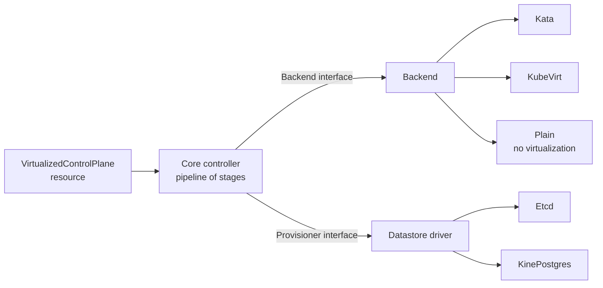
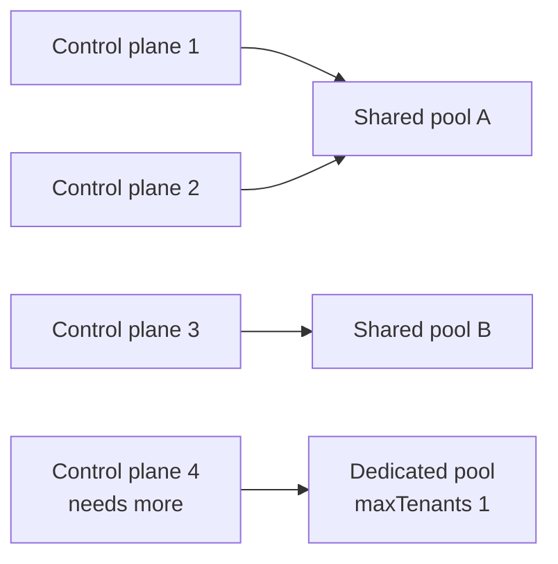
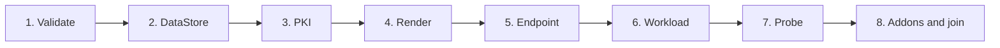

# Purpose and status {#sec-purpose}

The [comparison paper](hosted-control-plane-isolation.md) compares Kata and KubeVirt as the
virtualization layer for hosted control planes. This note works one layer up: the controllers we
would build to make either one real. It is a **sketch for discussion**. Field names and the API
group are placeholders, and nothing here has been built or tested.

**What this is for.** The goal is to compress control planes: reduce the resources each one
needs, run more of them per physical host, and so reduce the number of physical hosts. Running
each control plane inside a VM (a Kata microVM or a KubeVirt VM) is the mechanism that makes
dense packing workable. Isolation between control planes comes with that mechanism and must not
be lost, but it is not the property being developed. Density is, so the backends are judged first
on per-control-plane overhead and how many fit on a host.

**Four design principles**, in the order they break ties:

1. **Regularity.** Look like every other Kubernetes API. Where a convention exists, follow it
   and say so ([next section](#sec-conventions)).
2. **Ecosystem fit.** Work with `kubectl`, Cluster API, GitOps tools and the standard
   monitoring stack without adapters.
3. **Reliability.** A controller failure must not take running control planes down, and no
   single shared component should be able to take them all down.
4. **Operability.** Every state is visible through the API, events, metrics and logs in the
   standard forms, and every recovery path is one a tired operator can follow.

**Scope.** This is a from-scratch controller layer with its own API. It has no dependency on
Kamaji or its types. The functions it must cover are the ones in the paper's effort map (PKI,
datastore, endpoint, addons, join material, upgrades, Cluster API contract).

**The central idea.** Most of the work does not depend on the virtualization runtime. So the
design splits into a runtime-independent **core** and a narrow **backend** interface with one
implementation per runtime. The core decides *what* the control plane runs and *with which
material*. The backend decides *where and how* it runs. The datastore gets the same treatment: a
**provisioner** interface per datastore type.



The plain backend is not a candidate. It runs the same workload as ordinary pods, which gives
developers a baseline and lets continuous integration run on machines without `/dev/kvm`.

**Naming.** The main resource is `VirtualizedControlPlane`, not `HostedControlPlane`. HyperShift
already uses the kind `HostedControlPlane` (in its own API group). Two kinds with the same name in
different groups are technically legal, but they cause real confusion in documentation, searches,
short names and `kubectl` output if both are ever installed on one cluster.
`VirtualizedControlPlane` describes what the object is (a control plane running in a VM) without
naming a property we are not optimizing, as `Isolated` would. It follows the Cluster API pattern
`<Qualifier>ControlPlane`, as in `KubeadmControlPlane`. The datastore resource is
`VirtualizedControlPlaneDataStore`: the same prefix keeps the family together in
`kubectl api-resources`, mirrors the way Cluster API pairs `KubeadmControlPlane` with
`KubeadmControlPlaneTemplate`, and avoids colliding with other projects' `DataStore` kinds. The
generic phrase "hosted control plane" is still used in prose for the concept.

# Conventions we follow {#sec-conventions}

**This design deliberately follows existing Kubernetes and Cluster API conventions rather than
inventing its own.** Where a convention applies, we use it, and we mark it in the API sketch with
a `// CAPI contract:` or `// K8s convention:` comment so a reader can see which parts are
inherited and which are ours. Tools such as `clusterctl`, `kubectl wait`, and GitOps health checks
then work without adapters.

Sources: **[CAPI]** the Cluster API control plane contract, v1beta2; **[K8s]** the Kubernetes API
conventions; **[kstatus]** the status conventions used by `kubectl`, Flux and Argo CD health
checks; **[KB]** the Kubebuilder good-practices guide. Links are in
[the source list](#sec-conv-sources).

| Convention | What it asks | In this design | Status |
|--------------|----------------------------------|----------------------|----------|
| **[CAPI]** Resource shape | Namespace-scoped resource with a list type and a `status` subresource | `VirtualizedControlPlane` and its list type | Followed |
| **[CAPI]** Naming | `<Qualifier>ControlPlane`, a naming convention | `VirtualizedControlPlane` | Followed |
| **[CAPI]** Endpoint | Provider writes `spec.controlPlaneEndpoint` (host, port) when it generates the endpoint | The core writes it after the endpoint stage | Followed |
| **[CAPI]** Version | `spec.version` (required string); report running versions in `status.versions` (`status.version` is deprecated) | Both fields, `versions` only | Followed |
| **[CAPI]** Replicas | `spec.replicas`; status `selector`, `replicas`, `readyReplicas`, `availableReplicas`, `upToDateReplicas`; the **scale subresource** | All of them | Followed |
| **[CAPI]** Initialization | **Mandatory:** the control-plane-initialized flag under `status.initialization` | Set once the API first answers | Followed |
| **[CAPI]** Kubeconfig Secret | **Mandatory:** same namespace as the Cluster, named `<cluster>-kubeconfig`, type `cluster.x-k8s.io/secret`, label `cluster.x-k8s.io/cluster-name`, data key `value`; short-lived client certificates, regenerated periodically | Created and maintained by the core | Followed |
| **[CAPI]** Certificate Secrets | Optional: `<cluster>-<certificate>` (`ca`, `etcd`, `proxy`, `sa`) with the same type and label | Used when `pki.mode` is `BuiltIn` | Followed |
| **[CAPI]** Conditions | Optional: `Available` is mirrored to the Cluster's `ControlPlaneAvailable`; only `type`, `status`, `reason`, `message`, `lastTransitionTime`, `observedGeneration` are read | `Available` and `Paused` plus ours | Followed |
| **[CAPI]** Pausing | Check the Cluster's `spec.paused` and the `cluster.x-k8s.io/paused` annotation on the control plane; surface a `Paused` condition | Implemented; there is deliberately no separate `spec.paused` field | Followed |
| **[CAPI]** RBAC | The Cluster controller sets owner references and labels, so the provider needs matching permissions (including `finalizers` update on the owner) | Part of the deployment manifests | Followed |
| **[CAPI]** Machines | Conditional: only if control plane instances are represented as Cluster API Machines | They are not | Not applicable |
| **[CAPI]** ClusterClass | `ControlPlaneTemplate`, mandatory only to support ClusterClass | Not in the first version | Deferred |
| **[K8s]** Spec and status | Desired state in `spec`, observed state in `status`; a status subresource; writes to the main resource ignore `status` | As designed | Followed |
| **[K8s]** Condition shape | PascalCase `type` naming an observed state; `status` True, False or Unknown; `reason` required and CamelCase; `message`; set on first visit even if Unknown; per-condition `observedGeneration` | Every condition | Followed |
| **[K8s]** Polarity | Recommends **neither** positive nor negative polarity as a general rule | Positive for every state condition (see [below](#sec-polarity)) | Choice made, noted |
| **[kstatus]** Status contract | `Ready` (positive), `Reconciling` and `Stalled` (abnormal-true), top-level `observedGeneration` | All four | Followed |
| **[K8s]** Enum values | Strings in CamelCase with an initial capital (`ClusterFirst`, `ClientIP`); no dashes; proper names keep their casing | `Kata`, `KubeVirt`, `Plain`, `BuiltIn`, `CertManager`, `Etcd`, `KinePostgres`; the first draft used lowercase and dashes, now corrected | Followed |
| **[K8s]** Durations | Integer fields with the unit in the name (`leaseDurationSeconds`); the document says Kubernetes does not use a Duration type in the API | `certificateValiditySeconds`, `rotateBeforeSeconds`. Note: cert-manager uses a Duration type, so this differs from a neighbour we integrate with | Followed |
| **[K8s]** Boolean fields | "Think twice": booleans tend to grow into a set of options, so prefer a string enum | `nodeConnectivity` and `upgrade.onFailure` are enums, not booleans | Followed |
| **[K8s]** Object references | Name the field `{field}Ref` (or `{field}Name` when by name only); namespaced types refer only to same-namespace objects; do not copy values into the referrer | `dataStoreRef`, `issuerRef`, `credentialsSecretRef`; the one cluster-scoped reference is to an operator-owned kind | Followed |
| **[K8s]** Unions | All fields in a set optional; validate "exactly one"; no default | `virtualization.kata` / `virtualization.kubeVirt` | Followed |
| **[K8s]** Named lists | Lists of named sub-objects, not maps of sub-objects; set `listType` | Used wherever a collection of named items appears | Followed |
| **[K8s]** Validation | Every string has a format and a maximum length; numbers are bounds-checked; lists have a maximum size and a `listType`; messages use "must", "must not", "may not" | Applied as CRD validation markers on every field | Followed |
| **[K8s]** Events | A specific, short, CamelCase `reason` per event category | e.g. `CertificateRotated`, `DataStoreBound`, `EndpointUnreachable` | Followed |
| **[K8s]** Labels and annotations | Keys lowercase with dashes; unprefixed keys belong to users; our own keys use our domain; `kubernetes.io` and `k8s.io` prefixes are reserved | Our keys use our API group as the prefix; the `cluster.x-k8s.io` keys are those the Cluster API contract itself requires | Followed |
| **[K8s]** Short names | Short names collide unpredictably with other resources and with each other; use sparingly | One short name for the main kind, none for the datastore kind | Followed, cautious |
| **[K8s]** Deletion and ownership | Deletion waits for finalizers; owner references do not cross namespaces | Finalizer runs backend cleanup and the datastore policy | Followed |
| **[KB]** One controller per Kind | Do not have one controller reconcile several Kinds | One controller for `VirtualizedControlPlane`, one for the datastore kind | Followed |
| **[KB]** Idempotent reconcile | Reconcile from observed state, not from event type | Every pipeline stage | Followed |
| **[KB]** Log style | Capital first letter, no final period, past tense, name the object type, structured key-value pairs | Adopted for all controller logs | Followed |

## What "polarity" means {#sec-polarity}

A condition has a `status` of True, False or Unknown. **Polarity** is whether True is the good
answer or the bad one.

- **Positive polarity:** True means healthy. `Ready=True`, `Available=True`.
- **Negative polarity** (also called abnormal-true): True means something is wrong, and the
  condition is normally absent or False. `MemoryPressure=True`, `DiskPressure=True`.

Kubernetes itself mixes both: a Node reports `Ready` (positive) next to `MemoryPressure`
(negative). That is why the conventions document declines to pick one. The practical problem is
reading: a table of conditions where some True values are good and some are bad is easy to
misread, and tools need to know which kind each one is.

The rule here is simple. **Every state condition is positive**, so "all True" always means
"healthy" and `kubectl wait --for=condition=Ready` behaves as people expect. The only exceptions
are `Reconciling` and `Stalled`, which are negative because the kstatus library, and therefore
Flux, Argo CD and `kubectl`, define them that way. Example for one control plane: during an
upgrade `Ready` stays True, `Reconciling` is True, and `Stalled` is absent; if the rollout gets
stuck, `Stalled` becomes True with a `reason` and `message` saying why.

## Where we depart or have not decided {#sec-depart}

- **Machines are not used.** The contract only requires them for providers that model control
  plane instances as Cluster API Machines. A pod or VM per replica created directly by our
  backend is not one, so the Machine rules do not apply.
- **ClusterClass is deferred.** It needs a `ControlPlaneTemplate` resource, which is extra
  surface area. It can be added later without changing the main resource.
- **`Reconciling` and `Stalled` break one K8s naming hint.** The conventions document prefers
  names that describe an observed state, not a present-tense verb. We use these two anyway
  because they are the names that Flux, Argo CD and `kubectl` understand.
- **Polarity is a choice, not a rule.** Stated above so nobody reads it as the convention itself.
- **Immutability is ours.** The conventions document has no immutable-fields rule that applies.
  `spec.virtualization.backend` and `spec.dataStoreRef.name` are made immutable with CRD
  validation rules, a design decision and not an inherited convention.
- **Durations differ from cert-manager.** We follow the Kubernetes document (integer seconds),
  and convert when talking to cert-manager.

**What has been verified.** The Cluster API contract page was read in full. From the Kubernetes API
conventions document I read, in full: spec and status, conditions, metadata and finalizers,
references, primitive types, constants, unions, named lists, units, naming, short names and
categories, labels and annotations, events, optional versus required, and validation. I did not
read the sections that only matter for built-in resources (HTTP status codes, response status
kinds, WebSockets, automatic allocation). From the Kubebuilder guide I read the whole page. Two
Cluster API details are unconfirmed and must be checked at implementation time: the exact element
type of `status.versions`, and how the two pause checks combine. The contract keeps v1beta1
compatibility only temporarily (the page gives April 2027), so we target v1beta2.

# The API {#sec-api}

Two custom resources, in a placeholder group `controlplane.example.com/v1alpha1`. Strings carry a
maximum length, enums carry the allowed values, numbers carry bounds and lists carry a maximum
size and `listType`, as CRD validation markers (not shown in the sketch, to keep it readable).

## VirtualizedControlPlane (namespaced) {#sec-vcp}

One object per hosted control plane. It **is** the Cluster API control plane resource: a Cluster's
`spec.controlPlaneRef` points at it directly, so there is no separate wrapper resource. It has the
short name `vcp` and the category `cluster-api`, so `kubectl get cluster-api` lists it with the
rest of a Cluster API cluster.

```go
type VirtualizedControlPlaneSpec struct {
    // CAPI contract: spec.version, required string.
    Version string `json:"version"`
    // CAPI contract: spec.replicas; also the scale subresource's specReplicasPath.
    Replicas *int32 `json:"replicas,omitempty"`
    // CAPI contract: spec.controlPlaneEndpoint. We generate the endpoint, so the core
    // writes it. This is the one place the controller writes to spec.
    ControlPlaneEndpoint APIEndpoint `json:"controlPlaneEndpoint,omitempty"`

    // Ours from here on.
    Virtualization VirtualizationSpec `json:"virtualization"` // backend; IMMUTABLE
    DataStoreRef   DataStoreRef       `json:"dataStoreRef"`   // name IMMUTABLE for now
    Network        NetworkSpec        `json:"network"`
    PKI            PKISpec            `json:"pki,omitempty"`
    Identity       *IdentitySpec      `json:"identity,omitempty"` // optional SPIFFE/SPIRE wiring
    Components     ComponentsSpec     `json:"components,omitempty"`
    Addons         AddonsSpec         `json:"addons,omitempty"`
    Upgrade        UpgradeSpec        `json:"upgrade,omitempty"`
    // No spec.paused: pausing follows the CAPI contract (Cluster spec.paused or the
    // cluster.x-k8s.io/paused annotation on this object).
}

// K8s convention (unions): the backend-specific blocks are all optional, exactly one
// matching Backend is required, and none is defaulted.
type VirtualizationSpec struct {
    Backend  string        `json:"backend"`            // Kata | KubeVirt | Plain
    Kata     *KataSpec     `json:"kata,omitempty"`     // runtimeClassName, node selector
    KubeVirt *KubeVirtSpec `json:"kubeVirt,omitempty"` // image, storage class, delivery mode
}

// K8s convention (references): {field}Ref, same-scope or operator-owned objects only.
type DataStoreRef struct {
    Name         string      `json:"name"`                   // a VirtualizedControlPlaneDataStore
    DeletePolicy string      `json:"deletePolicy,omitempty"` // Retain (default) | Delete
    Backup       *BackupSpec `json:"backup,omitempty"`       // schedule + target
}

type NetworkSpec struct {
    ServiceType      string   `json:"serviceType"`                // LoadBalancer | ClusterIP
    Address          string   `json:"address,omitempty"`          // fixed address, if wanted
    DNSNames         []string `json:"dnsNames,omitempty"`         // become certificate SANs
    PodCIDR          string   `json:"podCIDR"`
    ServiceCIDR      string   `json:"serviceCIDR"`
    NodeConnectivity string   `json:"nodeConnectivity,omitempty"` // Direct (default) | Konnectivity
}

type PKISpec struct {
    Mode                       string     `json:"mode,omitempty"` // BuiltIn | CertManager
    IssuerRef                  *ObjectRef `json:"issuerRef,omitempty"`
    CertificateValiditySeconds int32      `json:"certificateValiditySeconds,omitempty"`
    RotateBeforeSeconds        int32      `json:"rotateBeforeSeconds,omitempty"`
}

type UpgradeSpec struct {
    MaxUnavailable *int32 `json:"maxUnavailable,omitempty"`
    OnFailure      string `json:"onFailure,omitempty"` // Pause (default; the only value at first)
}
```

`NodeConnectivity` is an enum rather than a boolean because the options are expected to grow
beyond on and off (the paper's section on the control plane to node path lists direct routing and
the Konnectivity tunnel, and others are possible). `ComponentsSpec` carries per-component
resources and extra arguments for the apiserver, controller-manager and scheduler. `AddonsSpec`
selects the tenant-side addons. `IdentitySpec` holds the trust domain and agent placement for
SPIFFE.

```go
type VirtualizedControlPlaneStatus struct {
    // CAPI contract (mandatory): set once the API has answered.
    Initialization struct {
        ControlPlaneInitialized *bool `json:"controlPlaneInitialized,omitempty"`
    } `json:"initialization,omitempty"`

    // CAPI contract: replica counts, and the scale subresource's selector and
    // statusReplicasPath.
    Selector          string `json:"selector,omitempty"`
    Replicas          *int32 `json:"replicas,omitempty"`
    ReadyReplicas     *int32 `json:"readyReplicas,omitempty"`
    AvailableReplicas *int32 `json:"availableReplicas,omitempty"`
    UpToDateReplicas  *int32 `json:"upToDateReplicas,omitempty"`

    // CAPI contract: running versions (status.version is deprecated, so not used).
    // The exact element type must be confirmed against the contract page.
    Versions []string `json:"versions,omitempty"`

    // K8s convention and kstatus: the generation the controller last acted on.
    ObservedGeneration int64 `json:"observedGeneration,omitempty"`
    // K8s convention: metav1.Condition, with per-condition observedGeneration.
    Conditions []metav1.Condition `json:"conditions,omitempty"`

    // Ours.
    DataStoreBoundName string       `json:"dataStoreBoundName,omitempty"` // what is really bound
    CertificatesExpire *metav1.Time `json:"certificatesExpire,omitempty"` // earliest
}
```

`dataStoreBoundName` is what lets the controller notice a mismatch between what was asked for and
what is actually bound, which matters when the binding is allowed to change later (see
[the datastore strategy](#sec-ds-strategy)). The kubeconfig is not a status field: the contract
fixes the Secret's name, type, label and key, so there is nothing to reference.

**Conditions.** All state conditions use positive polarity (see [above](#sec-polarity)). Each
carries `reason`, `message` and its own `observedGeneration`, and the controller sets every one on
its first reconcile, as `Unknown` if need be.

| Condition | Origin | True when |
|---|---|---|
| `Ready` | kstatus | `Available` is true and the control plane has fully converged: all replicas up to date, addons installed, certificates valid |
| `Available` | CAPI | The published endpoint returns 200 from `/readyz`. Mirrored to the Cluster's `ControlPlaneAvailable` |
| `Paused` | CAPI | Reconciliation is paused by the Cluster or the annotation |
| `DataStoreBound` | ours | The tenant has a working, per-tenant datastore binding |
| `CertificatesValid` | ours | All certificates and kubeconfigs exist and none is near expiry |
| `WorkloadAvailable` | ours | The backend reports the desired replicas running |
| `AddonsInstalled` | ours | Tenant-side addons are installed and healthy |
| `Reconciling` | kstatus | A change is being applied, including a version upgrade. Abnormal-true: present only while true |
| `Stalled` | kstatus | The controller cannot make progress without outside help. Abnormal-true |

`Available` matters most. The core probes the real API through the published address with a real
client certificate, instead of trusting the runtime's own status. For a VM, "running" says nothing
about whether the apiserver inside it is alive; the paper scores this as the silent-failure risk
(D2), and here it is closed in one place for every backend.

## VirtualizedControlPlaneDataStore (cluster-scoped) {#sec-datastore}

An operator-managed pool of datastore capacity that control planes bind to. A pool is just a
datastore plus a limit on how many control planes may share it. **A dedicated datastore is simply
a pool with `maxTenants` of 1**, so there is one concept, not two.

```go
type VirtualizedControlPlaneDataStoreSpec struct {
    Type      string   `json:"type"`                // Etcd | KinePostgres
    Endpoints []string `json:"endpoints,omitempty"`
    // Admin credentials. A secret reference needs a namespace here, because this kind is
    // cluster-scoped and the Secret is not.
    CredentialsSecretRef *SecretReference `json:"credentialsSecretRef,omitempty"`
    // How many control planes may bind to this pool. 1 makes it dedicated.
    MaxTenants int32 `json:"maxTenants"`
}

type VirtualizedControlPlaneDataStoreStatus struct {
    Tenants            int32              `json:"tenants,omitempty"`
    DatabaseSizeBytes  *int64             `json:"databaseSizeBytes,omitempty"`
    ObservedGeneration int64              `json:"observedGeneration,omitempty"`
    Conditions         []metav1.Condition `json:"conditions,omitempty"` // Ready, Full, ...
}
```

The datastore kind is **cluster-scoped and operator-owned**, while a control plane is namespaced.
The Kubernetes conventions warn against references that cross namespaces because they leak
information and have unclear deletion semantics; a reference from a namespaced object to a
cluster-scoped, operator-owned one does not have those problems, and it is the same pattern as a
PersistentVolumeClaim naming a StorageClass.

# Datastore strategy: start shared, grow to dedicated {#sec-ds-strategy}

**Decision for the first version: control planes bind to shared pools.** Density is the goal, and
a datastore per control plane is a large fixed cost (a three-member etcd per control plane is
three more processes with their own memory and disk). Sharing is the cheapest way to compress.

But shared comes with costs that are real for reliability and operability, so the design assumes
we **will** be pushed to dedicated for some tenants, and makes that a routine step.

| Concern | Shared pool | Basis |
|---|---|---|
| Blast radius | One overloaded or failed pool takes down every control plane bound to it | [I] |
| Local evidence | On this cluster a write storm made one etcd member slow enough to take its node intermittently NotReady and crash-loop the pods on it for about three hours. Restarting the process did not clear it; only a reboot did. That was one member of the management cluster's own etcd, not a tenant pool, but it shows how a loaded datastore drags down its dependents and how hard recovery can be | [M] `docs/etcd-under-pressure-postmortem.md` |
| Size limit | etcd has one storage quota for the whole database (default 2 GiB, suggested ceiling 8 GiB) and I know of no per-tenant quota | [I] from etcd documentation, not re-verified here |
| Noisy neighbour | One tenant's write rate, watch count or compaction load affects all | [I] |
| Backup and restore | An etcd snapshot covers the whole pool, so restoring one tenant means rewinding all of them or replaying one tenant's key prefix | [I] |
| Credentials | Per-tenant etcd user and role limited to a key prefix; each apiserver gets its own `--etcd-prefix` | [I] |

**Triggers for moving a tenant to a dedicated pool:** an availability target tighter than a shared
pool can give; a need to restore one tenant on its own; a tenant that outgrows its share or disturbs
its neighbours; a compliance requirement. None of these is expected on day one, but each is likely
eventually.



**Why starting shared is not a trap.**

1. **Bounded blast radius from day one.** Because `maxTenants` is mandatory, an operator can run
   several shared pools and spread them across failure domains. No single pool serves every
   control plane, even before any tenant is dedicated.
2. **The reference is already a name.** A control plane binds with `dataStoreRef.name`. Moving a
   tenant to a dedicated pool changes that name, not the shape of the API.
3. **The datastore is behind an interface**, like the runtime backend (below), so the core does not
   care whether a pool is etcd or Postgres, shared or dedicated.
4. **Moving is deferred but designed.** In the first version `dataStoreRef.name` is immutable, so a
   move means building a new control plane and restoring into it, the same story as changing
   backends. The planned improvement is to allow the name to change and have the controller run
   the move as a rollout: copy the data, briefly pause writes for a final sync, switch the
   apiservers, verify, release the old credentials. `status.dataStoreBoundName` records what is
   really bound during that time, and `Reconciling` is true with a reason of `DataStoreMigration`.

**The first pool type is an open choice** (see [open questions](#sec-open)). Shared **etcd** gives
native semantics and the best-understood performance, but a restore is pool-wide. Shared
**Postgres under kine** gives a database per tenant, which makes per-tenant backup and restore and
per-role limits routine, at the cost of kine's translation layer and its scaling behaviour with
many tenants, which is unmeasured here [?]. If tenant-level restore matters most, lean Postgres; if
API server performance matters most, lean etcd; either way a short spike should decide, and the
interface keeps the other open.

```go
type DataStoreProvisioner interface {
    Type() string

    // Give the control plane its own credentials and key prefix (etcd) or database and role
    // (Postgres). Idempotent. Returns where the apiserver should connect.
    Bind(ctx context.Context, pool *VirtualizedControlPlaneDataStore,
        vcp *VirtualizedControlPlane) (Binding, error)

    // Revoke access, and delete the tenant's data only if the policy says Delete.
    Release(ctx context.Context, pool *VirtualizedControlPlaneDataStore,
        vcp *VirtualizedControlPlane, policy string) error

    // Member health, database size against its limit, tenant count.
    Health(ctx context.Context, pool *VirtualizedControlPlaneDataStore) (PoolHealth, error)

    // Per-tenant backup and restore, where the type supports it.
    Backup(ctx context.Context, pool *VirtualizedControlPlaneDataStore,
        vcp *VirtualizedControlPlane) (BackupRef, error)
    Restore(ctx context.Context, pool *VirtualizedControlPlaneDataStore,
        vcp *VirtualizedControlPlane, from BackupRef) error

    Capabilities() StoreCapabilities // TenantBackup, TenantRestore, TenantQuota
}
```

`Capabilities` plays the same role as for backends: the core asks what a pool can do instead of
assuming it. A shared etcd pool would report no per-tenant restore, and the core would refuse to
promise one.

A final rule for reliability: **tenant data never goes into the management cluster's own etcd.**
Pools run as their own workloads, with their own members, backups and alerts. The incident above
is one reason.

# The core: reconcile pipeline {#sec-core}

The core reconciles in ordered stages. Each stage is idempotent, sets its own condition, and stops
the pipeline when it cannot proceed. The staged shape is a common controller-runtime idiom rather
than a standard; the standards are the contract surfaces above.



1. **Validate.** Check the spec, and ask the chosen backend to validate its own block. Also
   enforced at admission time by a webhook. Honour the pause check first.
2. **DataStore.** Wait until the named pool is `Ready` and not `Full`, then bind through the
   provisioner. Start-up ordering comes from this wait, not from a script.
3. **PKI.** Build the certificate authorities, then the apiserver serving certificate, client
   certificates, front-proxy material, the service-account keypair and the kubeconfigs. Track
   expiry and re-issue before it. Secrets follow the contract's naming where it applies.
4. **Render.** Turn the spec into a `ControlPlaneSpec`: the exact list of components to run, with
   image, arguments, ports, probes and the secrets each one needs (see
   [the boundary](#sec-boundary)). Identical for every backend.
5. **Endpoint.** Create the Service or load balancer, publish the address and DNS names, and write
   `spec.controlPlaneEndpoint`.
6. **Workload.** Hand the rendered spec to the backend.
7. **Probe.** Call `/readyz` through the endpoint. Only this sets `Available`, and the first
   success sets `status.initialization.controlPlaneInitialized`.
8. **Addons and join.** Once the API answers, install addons into the tenant cluster and publish
   bootstrap tokens and `cluster-info` for worker joins. Then write the contract's
   `<cluster>-kubeconfig` Secret and the status.

**Cross-cutting behaviour.**

- **Ownership and deletion.** Every object the controller creates is owned by the
  `VirtualizedControlPlane`, so garbage collection removes it. A finalizer runs the backend's
  cleanup and applies the datastore delete policy, with `Retain` as the default so that deleting
  the resource never silently destroys tenant data.
- **One namespace per control plane**, with a default-deny network policy. On this cluster Cilium
  enforces it, so each namespace also needs the kubelet-probe allow policy described in
  `docs/cilium.md`, or health probes are blocked.
- **Upgrades.** When `spec.version` changes, the core builds a plan (datastore first if required,
  then apiservers, then controller-manager and scheduler), respects Kubernetes version-skew
  rules, and drives the backend through it one step at a time, pausing on failure. `Reconciling`
  is true throughout.
- **Cluster API.** The resource implements the contract directly, as listed in
  [Conventions we follow](#sec-conventions). It can also run without Cluster API, in which case
  the Cluster-related rules (the owning Cluster, its pause switch) are simply absent.

# The boundary: what the core hands the backend {#sec-boundary}

The core does the thinking and hands over a runtime-neutral description. The backend never decides
flags or certificates; it only decides how to run what it is given.

```go
// What to run. Rendered once by the core, identical for every backend.
type ControlPlaneSpec struct {
    Components []ComponentSpec // kube-apiserver, controller-manager, scheduler (+ agent)
    Material   []MaterialRef   // Secrets that must exist in the workload, with target paths
    Endpoint   Endpoint
    Replicas   int32
}

type ComponentSpec struct {
    Name      string
    Image     string // resolved from spec.version
    Args      []string
    Env       []EnvVar
    Ports     []Port
    Probes    Probes
    Mounts    []MountRef // which Material appears at which path
    Resources corev1.ResourceRequirements
}
```

```go
type Backend interface {
    Name() string

    // Static checks on the spec; called from the webhook and from stage 1.
    Validate(vcp *VirtualizedControlPlane) field.ErrorList

    // Make the workload match the desired control plane. Idempotent. Creates and
    // updates only objects owned by vcp.
    Reconcile(ctx context.Context, vcp *VirtualizedControlPlane,
        desired ControlPlaneSpec) (WorkloadStatus, error)

    // Report workload health from the backend's own point of view.
    Observe(ctx context.Context, vcp *VirtualizedControlPlane) (WorkloadHealth, error)

    // Move to the new version one step at a time. Called repeatedly until done.
    Roll(ctx context.Context, vcp *VirtualizedControlPlane, plan RollPlan) (RollProgress, error)

    // Deliver changed Material to the running workload. Returns whether the workload
    // must be restarted for the change to take effect.
    Deliver(ctx context.Context, vcp *VirtualizedControlPlane,
        changed []MaterialRef) (needsRestart bool, err error)

    // Delete everything the backend created. Called from the finalizer.
    Cleanup(ctx context.Context, vcp *VirtualizedControlPlane) error

    // What this backend can do, so the core can choose live update versus restart.
    Capabilities() Capabilities
}

type Capabilities struct {
    LiveMaterialUpdate bool // rotated Secrets reach a running workload
    InPlaceUpgrade     bool // can upgrade without replacing the workload
    LiveMigration      bool // workload can move between nodes without a restart
}
```

`Capabilities` is how the paper's Secret-rotation analysis becomes code. The core never assumes
live propagation; it asks. If `LiveMaterialUpdate` is false, or `Deliver` says a restart is needed,
the core rotates by rolling the workload instead.

# The backends {#sec-backends}

| | Kata | KubeVirt |
|---|---|---|
| Workload object | A Deployment (apiserver replicas), plus a StatefulSet if a dedicated datastore runs here | A set of `VirtualMachine` objects, one per replica |
| Component images | The stock upstream images, one container per component | A guest image per Kubernetes version, containing the binaries |
| How components run | Containers in one pod, all inside one microVM | Systemd units or static pods inside the guest, started from the rendered spec |
| Where the spec lands | `ComponentSpec` maps almost one-to-one onto a container | `ComponentSpec` is rendered into unit files or manifests in the guest |
| Material delivery | Mounted Secrets; the kubelet syncs them, which took 57 s to reach a running pod [M] | Secrets as a **virtiofs** filesystem propagate [M]; a Secret disk or cloud-init never updates [M] |
| Extra pieces to build | VM sizing from pod resources [?]; node selection for Kata-capable nodes | A golden-image build pipeline; a CDI or storage dependency; in-guest process supervision |
| `Observe` | Pod readiness | VM and guest-agent status. Not trusted alone, see the `Probe` stage |
| `Roll` | Deployment rollout with a surge, gated on health | Replace one VM at a time, gated on health (in-place upgrade possible, not preferred) |
| `Capabilities` | Live material update yes; in-place upgrade not applicable; live migration no | Live material update only with virtiofs; in-place upgrade yes; live migration yes with shared storage |

Sizes are different, as the paper's scorecard says. The Kata backend is a thin translation layer.
The KubeVirt backend carries an image pipeline and guest bootstrap that the Kata backend does not
need, and that work is the main cost of choosing it. Since density is the goal, the first thing to
measure on each is the footprint of one control plane and how many fit on a node.

**What "reversible" means here.** Two different things:

- **For the project: yes.** The core is shared, so choosing the other runtime later means writing
  a different backend, not rewriting the controller.
- **For one running control plane: not automatic.** `spec.virtualization.backend` is immutable in
  this sketch, because a Kata pod and a KubeVirt VM are different objects. Moving a live control
  plane is possible but is a rollout, not a switch: start replicas under the new backend using the
  same datastore binding and the same certificates, wait until they pass the endpoint probe, move
  the endpoint, then retire the old replicas. The controller-manager and scheduler use leader
  election through leases in the tenant API, so old and new replicas can coexist during the
  changeover. No datastore restore is needed because the datastore is a separate pool and not part
  of the workload being replaced. The core's upgrade machinery could automate this later by
  allowing the backend field to change.

# Operating it: reliability and operability {#sec-ops}

This section applies the four principles to the controller itself. "Basis" says where a practice
comes from: **[S]** a source read for this note, **[I]** inference or general practice, not
re-verified here.

| Concern | Practice | Basis |
|---|---|---|
| **Static stability** | Running control planes must not depend on the controller. Every object the controller creates serves traffic on its own. If the controller is down, control planes keep running; only changes and certificate renewal wait. | [I] |
| **Certificate renewal window** | The one thing that does depend on the controller over time is certificate renewal. So certificates rotate well before expiry (`rotateBeforeSeconds`), and an alert fires on `certificatesExpire` long before an outage could matter. | [I] |
| **Controller availability** | Run two or more controller replicas with leader election, so a node failure does not stall reconciliation. | [I] standard controller-runtime practice |
| **One controller per Kind** | A controller for `VirtualizedControlPlane` and a separate one for the datastore kind. The runtime backend and the datastore driver are libraries called from them, not controllers. | [S] Kubebuilder guide |
| **Idempotent reconcile** | Reconcile from observed state, never from the event type. This is what makes restarts, upgrades and cold starts safe. | [S] Kubebuilder guide |
| **Rate limits and backoff** | Bound concurrent reconciles per controller and use the work queue's back-off, so a cluster-wide event (a cold start of every control plane) does not overload the API server or the datastore pools. | [I] |
| **Start-up ordering** | Ordering comes from conditions, not scripts: stage 2 waits for the pool to be `Ready`. This lab shuts the cluster down nightly and starts it in the morning, which is a free daily test that everything converges unaided. | [I]; the nightly cycle is in `docs/cluster-night-mode.md` |
| **Status and events** | Conditions for state, events for transitions, each with a specific CamelCase reason. | [S] API conventions |
| **Logs** | Capital first letter, no final period, past tense, name the object type, structured key-value pairs. | [S] Kubebuilder guide |
| **Metrics** | The standard controller-runtime metrics plus a few of our own: time to `Available` per control plane, earliest certificate expiry, tenants and database size per pool. | [I] |
| **Alerts** | `Stalled` for too long; certificate expiry inside a threshold; a pool near `maxTenants` or near its size limit; time to `Available` above a threshold. All map to metrics above. | [I] |
| **`kubectl` experience** | Printer columns for `Ready`, `Available`, version, endpoint and age; the short name and category above; `kubectl wait --for=condition=Available` works because the condition follows the convention. | [S] short names; [I] columns |
| **GitOps** | The controller writes one spec field (`controlPlaneEndpoint`, because the contract says so). When Flux or Argo CD also applies the object, that field needs a distinct server-side-apply field manager, and manifests must leave it out, or the tools will fight. Document this. | [I] |
| **API versioning** | Start at `v1alpha1`, promote with conversion when versions diverge, and track the Cluster API contract version separately. | [I] |
| **Security** | Secrets live only in the control plane's own namespace; the controller never copies secret values into status or events; the controller's permissions are least-privilege; webhook certificates come from cert-manager. | [S] reference rules; [I] the rest |
| **Failure domains and drains** | Spread replicas across nodes and failure domains and protect them with disruption budgets. Backends differ in what a node drain does: a Kata pod is evicted respecting the budget; a KubeVirt VM may live-migrate or restart depending on its eviction setting. The backend must declare which. | [I] |
| **Root material backup** | The cluster CAs and service-account keys are the one thing that cannot be regenerated: losing them strands every tenant cluster. Back them up outside the management cluster, for example into the secrets manager this lab already runs (OpenBao). | [I] |

# What to reuse and what to build {#sec-reuse}

| Concern | Direction |
|---|---|
| Controller framework | Go with controller-runtime and kubebuilder |
| Certificates | Decision needed: build the CA handling in the core, or integrate cert-manager through `pki.issuerRef`. Both are supported by the API sketch |
| Datastore | Reuse an existing etcd operator or a managed Postgres under kine; the provisioner only creates per-tenant access, it does not become a database operator |
| Backups | Snapshot jobs driven by `dataStoreRef.backup`; restore is part of the new-control-plane path above |
| Testing | Unit-test the core against a fake backend and a fake provisioner; run the plain backend in CI; run the Kata and KubeVirt backends on the lab cluster |

# Open design questions {#sec-open}

1. **First pool type: shared etcd or shared Postgres under kine?** The trade-off is set out in
   [the datastore strategy](#sec-ds-strategy). A short spike measuring per-tenant restore effort
   and API server latency under several tenants should decide it.
2. **Does a dedicated datastore run inside the VM boundary?** A dedicated pool is the case where it
   could: etcd in an ordinary pod beside VM-wrapped apiservers leaves tenant data and credentials
   outside the boundary, but running it inside costs density. If it moves inside, the datastore
   becomes a second workload for the backend interface.
3. **One workload per replica, or one per component?** The sketch assumes each replica holds the
   apiserver, controller-manager and scheduler together (the latter two use leader election).
   Separating them changes the failure model and the cost.
4. **Certificate authority: built in or cert-manager?** And how SPIFFE-issued identity fits for
   components that read certificate files, which is the open reload question in the paper.
5. **In-place upgrade or replace?** The KubeVirt backend can do either; replacing is simpler to
   reason about and matches the Kata backend.
6. **ClusterClass support.** Whether and when to add a `ControlPlaneTemplate`, and how the Cluster
   API contract version policy is tracked.
7. **Scale.** How many control planes per management cluster and per pool, and what the
   controller's own reconcile load looks like at that number.
8. **Drain behaviour as part of the backend contract.** Whether `Capabilities` should declare what a
   node drain does to the workload.

# Suggested next steps {#sec-next}

These steps are tracked as the epic [#22](https://github.com/skeptomai/k3s-experiments/issues/22),
with the first items (decisions and the datastore spike) as issues #23 to #29.

1. Agree the core/backend split and the datastore pool model, the two decisions this note exists
   to test.
2. Confirm the two unverified Cluster API details listed under
   [Conventions we follow](#sec-conventions).
3. Run the datastore spike from open question 1.
4. Prototype the core with the plain backend and a shared pool: `VirtualizedControlPlane` to a
   working tenant API, including PKI, endpoint probe and kubeconfig.
5. Add the Kata backend, then the KubeVirt backend including its guest image pipeline. Measure
   footprint per control plane and packing density on each, since density is the goal, and feed
   both back into the comparison paper's scorecard.

# Sources for the conventions {#sec-conv-sources}

- Cluster API, [Contract rules for ControlPlane](https://cluster-api.sigs.k8s.io/developer/providers/contracts/control-plane) (contract version v1beta2). Read in full.
- Kubernetes, [API conventions](https://github.com/kubernetes/community/blob/master/contributors/devel/sig-architecture/api-conventions.md). The sections listed under "What has been verified" were read directly.
- Kubebuilder, [Good practices](https://book.kubebuilder.io/reference/good-practices). Read in full.
- Kubernetes, [Condition reference](https://kubernetes.io/docs/reference/kubernetes-api/definitions/condition-v1-meta/).
- Kubernetes, [KEP-1623: Standardize Conditions](https://www.kubernetes.dev/resources/keps/1623/).
- [kstatus](https://pkg.go.dev/sigs.k8s.io/cli-utils/pkg/kstatus): the status conventions used by tooling.
- HyperShift, [controller architecture](https://hypershift-docs.netlify.app/reference/controller-architecture): the existing `HostedControlPlane` kind, which is why this resource is not given that name.
- This repository: `docs/etcd-under-pressure-postmortem.md` (shared-datastore incident), `docs/cluster-night-mode.md` (nightly shutdown and start-up), `docs/cilium.md` (kubelet-probe policy).
